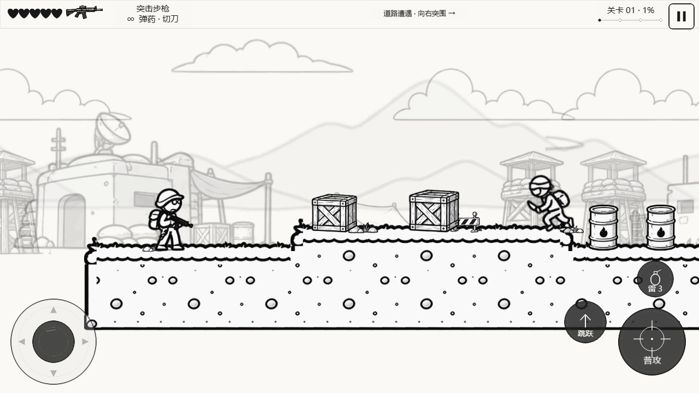
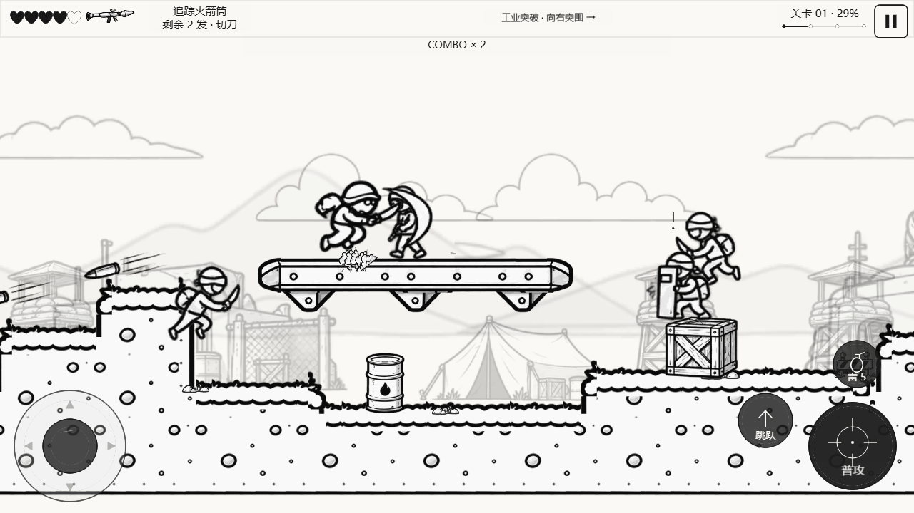
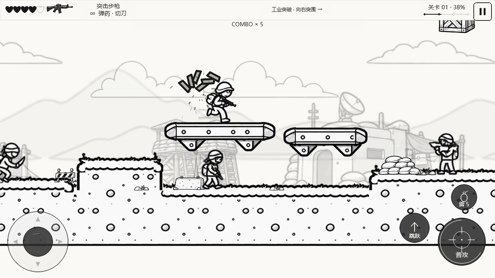
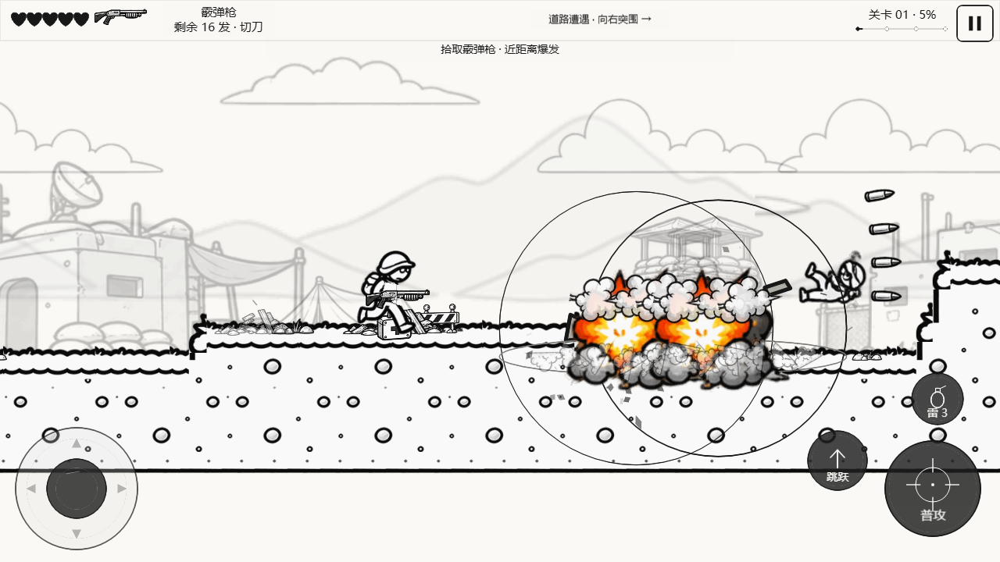
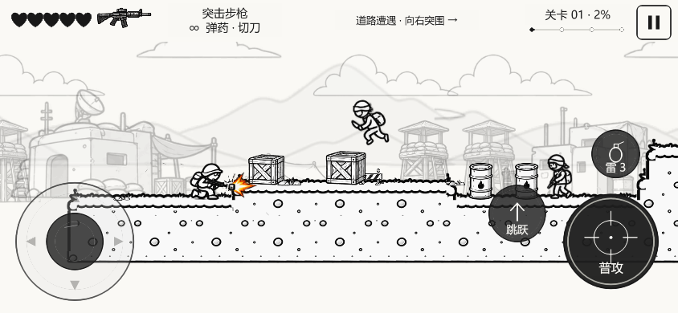

# V0.5.3 资源接入交付记录

2026-10-16。本轮直接修改现有 Cocos Creator 工程，先检查第一屏和前两段；没有重新生成美术、降低敌人强度或把参考图当地图。

## 使用资源与切片

| 提供文件 | 实际用途 |
|---|---|
| 卡通士兵动作精灵表.png | 玩家十二类动作，全身帧，六帧蹲走 |
| 黑白军用角色与坦克精灵图集.png | 步枪兵、刀兵、盾兵、火箭兵、坦克损伤和死亡 |
| 卡通射击游戏特效与武器精灵图集.png | 三种枪、手雷、补给、弹体、枪火、材质命中、七阶段爆炸 |
| 黑白平台游戏环境精灵素材表.png | 点状土块、金属浮台、木台/石台切片、箱桶、掩体、建筑和远山云 |
| 黑白涂鸦战场_突击关卡.png | 仅视觉参考，不进入运行图集 |

源图及 SHA256 在 `source/v053` 与 [manifest](manifest.json)。179 个独立切片、33 组序列；兼容名称为新切片的别名，不是旧版人物。所有 sprite ID、主角/敌人/武器状态映射见 [完整资源说明](README.md)，可打开 [透明背景预览页](preview.html)。

## 核心修改

- `scripts/prepare-comic-v053.py`、`ComicFrames.ts`、`assets/resources/comic/comic.png`：实际尺寸/透明度检查、逐帧裁切、统一源像素比例、脚底/枪口元数据、纹理边缘留白、确定性图集。
- `ComicPose.ts`、`ComicActorArt.ts`、`StickmanRenderer.ts`：整帧人物与状态机映射，按位移推进蹲走，盾牌方向与盾破状态一致，坦克按血量切换破损帧。
- `WeaponSystem.ts`、`ComicCombatArt.ts`、`CombatRenderer.ts`、`ProjectileManager.ts`：枪口坐标和空中动画 getter 修正；闪光跟随当前持枪者；明显弹体/尾烟；木、金属、敌人独立命中图；爆炸按七帧渐扩，烟团延迟消散，原碎片、扬尘、震屏继续使用。
- `ComicLevelRenderer.ts`：清洁平顶土块跟随真实坡面，小段路面选择短块避免过度压缩；金属浮台替代不自然长支架；远景淡化视差。
- `ComicObjectArt.ts`：油桶销毁使用短时竖向爆裂，不再压成扁残骸；沙袋压低原沙袋形体，避免误用木箱碎片。独立破损沙袋帧仍待补。
- `GameManager.ts`、平台版本、HUD、Web 缓存：0.5.3 标识和只读人物帧诊断。触控布局/多指所有权沿用。
- 新逻辑和浏览器测试验证实际状态、alpha/来源、碰撞、第一屏/第二段截图。自动驾驶仅调整按键策略，没有修改游戏生命、敌人或弹药。

## 截图

以下图片均来自最终 V0.5.3 Cocos Web 构建的真实按键试玩，不是概念图。前两段实际推进到 x>3800，包含三种武器、爆炸、盾兵和火箭兵。

第一屏：

第二段（金属浮台、盾兵、火箭弹）：

第二段后部（火箭兵）：

爆炸阶段：

蹲走射击：

## 当前功能边界

已接入：完整主角帧、普通兵/刀兵/盾兵/火箭兵、坦克各阶段、三种弹体、手雷、不同材质命中、七帧爆炸、土块与机械浮台、箱桶破损/销毁和浅色视差。步枪1100/0.14s、霰弹六颗/0.48s、火箭460/0.95s、敌人参数和地图敌人数未下调。

仍缺：最终巨型步行 Boss 新素材；向上瞄准及特殊武器配套手臂；破损沙袋/混凝土专帧。特殊武器当前覆盖完整持枪帧，极端角度仍需精修。源图姿势间比例有差异，并非骨骼插值动画；后段装配未逐处人工验收。已切出的木台/小石台没有强行堆入前两段。

## 验证

- 严格 TypeScript 检查通过。
- 76/76 逻辑检查通过：帧映射、六帧蹲走、空中枪口、原碰撞/破坏、二段跳、盾牌方向、整关及绕敌返回。
- 最终构建的 34 项浏览器回归全部首次通过：六帧蹲走射击、第一屏/前两段、资源加载/失败回退、多种横屏尺寸/DPR、竖屏暂停、摇杆、多指取消/独立操作、二段跳、武器/破坏/爆炸、存活敌人绕过及 Boss 撤退再进入，应用错误为零。
- 整关另有真实按键通关记录：第三次尝试、101.64 游戏秒、剩余2生命、最终Boss0生命、22击杀、子弹池丢弃0。它发生在最后的裁切边缘/物件绘制修正之前；之后未改玩法逻辑，最终包只重测上述34项，不声称35项在同一轮全部首过。
- 保留旧套件报告 `../reports/browser-before-final-visuals.json`：当时触控检查使用墙钟等待、绕敌自动驾驶途中死亡。触控检查改为固定游戏时间，绕敌策略以34ms节奏输入后在最终包通过；未降低敌人攻击或给测试玩家额外血量。
- Web 和微信小游戏均由 Creator 官方构建器构建成功（退出码36）；Web总文件5,386,886字节，微信包2,642,569字节（约2.52MiB），运行图集610,613字节/2048×2048。交付检查通过，见 [验证记录](../reports/verification.json)。
- 未实测：微信开发者工具运行、Android/iOS/微信真机、持续60FPS/内存、Safari系统栏/PWA。桌面模拟多指触控不能代替手机实测。
- 2026-10-16 15:02（北京时间）已上传微信小游戏开发版 0.5.3，AppID `wx7d2aae02691fc088`，版本说明标注开发者 YF，上传通道 CI机器人1。微信返回主包2,633,121字节；[上传回执](../reports/wechat-upload.json)保留构建哈希。未提交审核或公开发布；GitHub Pages未更新。
