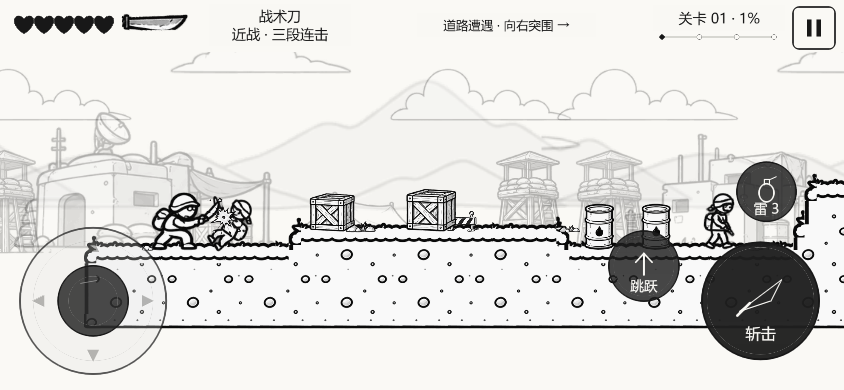
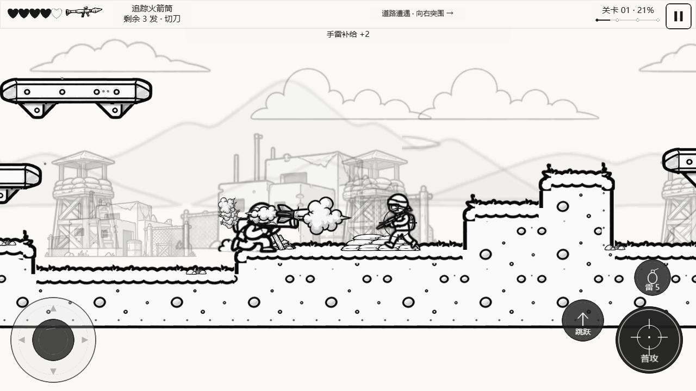

# V0.5.4：近战、矩形地形、追踪弹与敌人脱困

日期：2026-10-19。沿用 V0.5.3 提供的四张图集及现有 Cocos 工程，没有重新生成或替换美术来源。

## 操作与规则

| 功能 | 当前行为 |
| --- | --- |
| 普攻近战 | J、右侧普攻或右半屏射击长按：正前方近敌进入范围时自动挥刀，其余时间射击；L 可主动挥刀 |
| 刀击 | 88 单位范围、64 单位垂直判定；4 伤害；70ms 前摇、280ms 演出、480ms 间隔；每次挥刀对每个目标最多命中一次 |
| 近战防御 | 掩体挡刀；盾牌正面防御，绕后全伤；受击/死亡/投掷取消挥刀，暂停冻结，重开清理 |
| 弹体 | 步枪 86×19、独立霰弹丸 30×11、火箭宽116；物理碰撞半径及原武器伤害不随图片变大 |
| 追踪火箭 | 拾取原火箭筒补给即可使用；发射80ms后，在680单位、前方1.05弧度范围内寻找无遮挡目标；最大转速2.5弧度/秒 |
| 追踪边界 | 只追踪敌人，不追踪箱子；失去目标后重新搜寻或直飞，保留实体碰撞与射程；敌方火箭不追踪 |
| 矩形凹凸 | 水平浅平台与垂直边缘，保留浅沟；双向踏上浅台阶。空中从低处撞高台时由侧面阻挡，不会穿地 |
| 敌人脱困 | 地面刀兵、步枪兵、盾兵连续受阻后跳越，空中保持短时前进；守高台单位和固定火箭兵不乱跳 |

## 核心文件

- `assets/scripts/combat/MeleeSystem.ts`、`core/GameSession.ts`、`core/GameConfig.ts`：近战、追踪参数与战斗编排。
- `core/InputManager.ts`、`platform/CocosInputAdapter.ts`、`core/Types.ts`、`player/PlayerController.ts`：L 输入边沿、近战状态与重开清理。
- `level/TerrainProfile.ts`、`level/LevelController.ts`、`render/ComicLevelRenderer.ts`：矩形地形、空中侧撞、匹配的地面绘制。
- `enemy/EnemyController.ts`：脱困跃进与固定火箭兵击退修正。
- `combat/ProjectileManager.ts`、`combat/WeaponSystem.ts`：有视线限制的有限转速追踪、目标失效、对象池清理。
- `render/ComicCombatArt.ts`、`render/ProjectileArt.ts`、`render/CombatRenderer.ts`：弹体放大、锁定标记、刀刃与斩击弧。
- `render/ComicPose.ts`、`render/ComicActorArt.ts`、`render/StickmanRenderer.ts`：完整资源人物动作接入。
- `tests/v054-combat.test.cjs`、`tests/browser/00-v054-combat.spec.ts`：近战、追踪、地形、脱困与真实输入回归。

## 实际画面

这些截图来自当前 Cocos Web 游戏的真实键盘/触控操作，没有传送、修改血量或把参考图当背景。

## 验证与限制

- 严格 TypeScript 检查通过；84/84 逻辑测试通过，包括原完整关卡输入通关、双 Boss、跳过敌人激活与返回路线、双向台边碰撞。
- 最终浏览器整套 36/37 通过，剩余武器检查因追踪转向后的浮点速度 `460.00000000000057` 与 `460` 严格比较失败；改为8位小数容差后单项通过，游戏代码及构建未变。原始整套报告与单项复测分别保存，最终37项均有通过证据。
- 当前最终包整关真实按键首轮通过：176.34游戏秒，剩余2生命，双Boss击败，22击杀、0运行错误、0丢弃子弹。跳过普通敌人的进入Boss/返回路线另测通过。
- Web包5,401,133字节，微信包2,648,627字节（约2.53 MiB）；横屏、真实AppID、无核心DOM依赖的交付检查通过。
- Web 与微信小游戏均使用 Cocos Creator 3.8.8 官方构建成功。最终浏览器计数、通关血量、重试及构建大小见 `reports/verification.json`；该检查只接受本轮完整浏览器运行，不沿用旧版通关。
- 浏览器自动化验证不代表手机实机性能；微信开发者工具、iOS/Android 微信内触控、持续60FPS仍未验证。
- **临时表现**：没有独立主角持刀帧，因此使用给定投掷序列的蓄势/挥臂身体帧加刀刃和斩击弧。后续可以补专用帧，不影响本轮近战判定。
- 既有巨型 Boss 缺素材、特殊武器高角度手部对齐等限制保留，见 V0.5.3 交付记录。
- 本轮没有上传微信或 GitHub Pages。微信开发版本仍以 `reports/wechat-upload.json` 中此前0.5.3回执为准。
