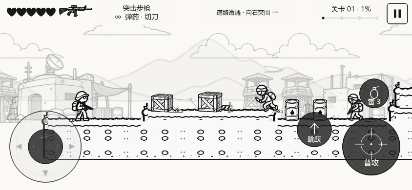
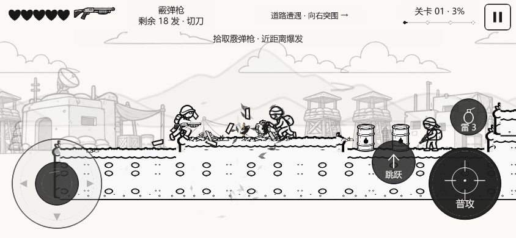
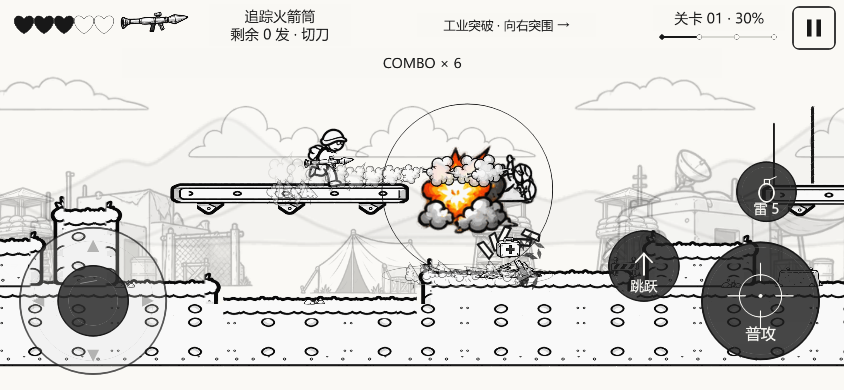

# V0.5.5：可拼接地图与换枪重叠修复

日期：2026-10-19。沿用现有Cocos Creator 3.8.8工程；地图碰撞、敌人参数与原有操作不改。

## 实际使用的资源

新图：`art/source/v055/黑白漫画可拼接地形.png`，1448×1086、RGBA，原图透明背景。保存源文件SHA256、实际裁切矩形、锚点与缩放规范于 `art/v055-manifest.json`。

- 9个地面模块：top / fill / bottom 各有 left / middle / right。
- 3个金属平台模块：left / middle / right，用于静态浮台、升降台与桥。
- 4个附加模块：左右高低转角、立柱、悬空台边。已裁切供扩展，本轮实际关卡使用前12种模块，不为了使用全部形状改变碰撞几何。
- 42个 `unarmed.player.*` 与42个 `grip.player.*`：从此前给定士兵动作切片清除步枪像素，保留原图身体、腿部、头部、背包与手部像素；不是新生成的角色。
- 共100项新增切片，一张2048×1024补充图集，137,637字节，RGBA理论占用8MiB；加原图集共两张，理论24MiB。资源预览：`art/v055-preview.html`。

## 拼接规则

1. 地面采用0.6等比缩放，平台采用0.5等比缩放；每个小模块X/Y缩放一致。
2. 加长区域重复中段；最后一块不足宽/高时截取相应UV，不压缩圆点、铆钉、草边和黑色边线。
3. 立面由填充行重复，不把短地块拉成高柱。短台阶保留清晰的左右边线，顶面与真实站立高度对应。
4. 先按整个碰撞体排布，再分配到渲染分块。800单位分块边界不增加端头；地面白底位于所有贴图之后，避免盖掉跨界的拼接块。
5. 远山去掉单独指定的高度，随源图宽高比显示。

## 武器修复

根因是士兵整帧图片里已经画有步枪，旧逻辑在上面再次叠加霰弹枪/火箭筒。现在统一由 `ComicEquipment` 选择：

| 情况 | 渲染内容 |
| --- | --- |
| 原步枪水平动作 | 原始完整动作帧，不另画第二把枪 |
| 霰弹枪/火箭筒 | 清除原枪的完整身体变体 + 一把当前武器 + 保留的原图手部层 |
| 仰角步枪 | 去枪身体变体 + 旋转的一把步枪 |
| 投掷、挥刀、死亡 | 对应完整动作，不叠加常规持枪层 |
| 弹药耗尽回步枪 | 原帧恢复，独立武器和手部附加层由节点池清理 |

源帧尺寸和脚底锚点没有变，枪口与开火位置共用校准数据。极端仰角仍缺配套手臂素材，姿势精修属于后续资源工作。

## 核心文件与验证

`scripts/prepare-comic-v055.py`、`SupplementFrames.ts`、`ComicFrames.ts`、`ComicAssets.ts`、`TerrainTiles.ts`、`ComicLevelRenderer.ts`、`ComicObjectArt.ts`、`ComicEquipment.ts`、`ComicActorArt.ts`、`ComicPose.ts`。

严格类型检查与87项逻辑测试通过，其中包含当前完整关卡输入通关；新增原图追溯、拼接覆盖、UV边界、去枪选择和回切回归。最终Web浏览器实测、构建大小和范围见 `reports/v055-verification.json`，原始浏览器报告为 `reports/v055-browser-results.json`。

最终8/8浏览器测试通过：前两段真实操作、近战、追踪、三指触控、蹲走/瞄准、三种武器拾取与弹药耗尽回切。新流程走到x=3904、剩余5生命、无运行错误。Web构建5,570,026字节；微信构建2,803,571字节（约2.67MiB）。

重建资源时先运行 `scripts/prepare-comic-v053.py`，再运行 `scripts/prepare-comic-v055.py`，后者恢复合并帧索引；两者需要Pillow和NumPy。不得只运行旧脚本后直接构建本轮源码。

截图来自当前Web实际输入和拾取；没有传送或改血量。当前浏览器验收集中前两段、三种武器及移动输入，上一轮完整真实按键通关证据独立保留，不冒充本轮复测。微信构建不等同于微信真机验证；Android/iOS、微信开发者工具、持续60FPS未测。此轮没有上传或发布。
