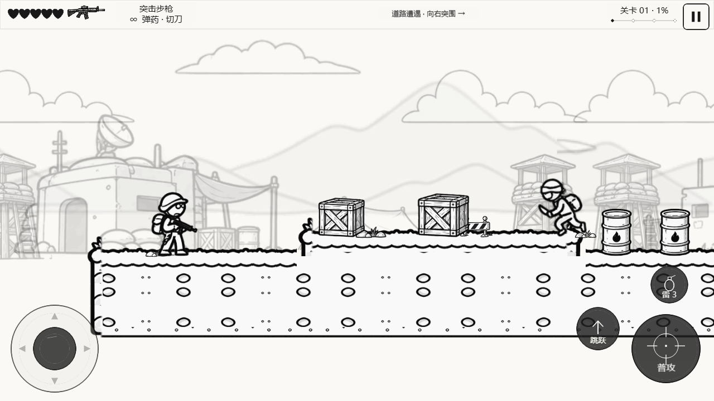
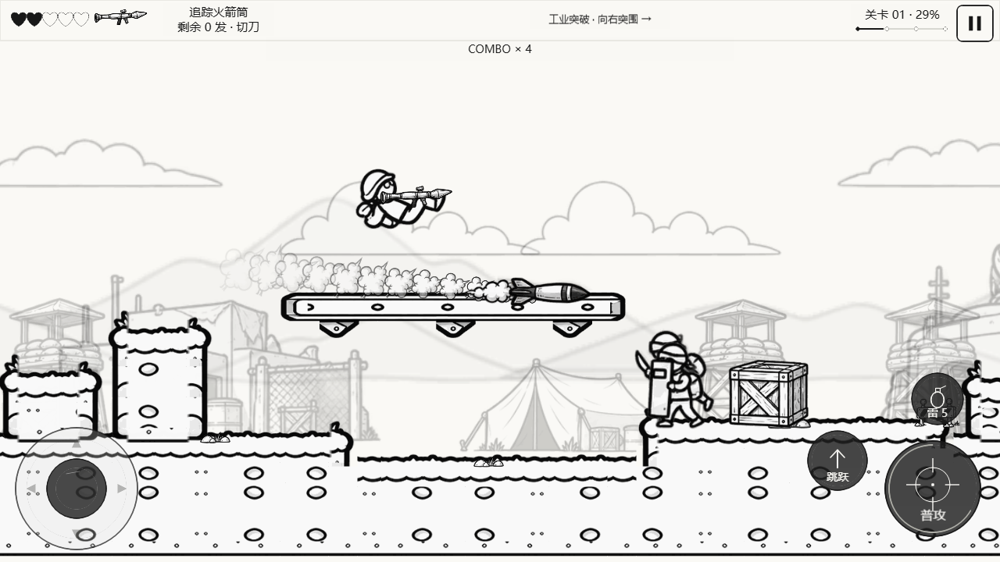
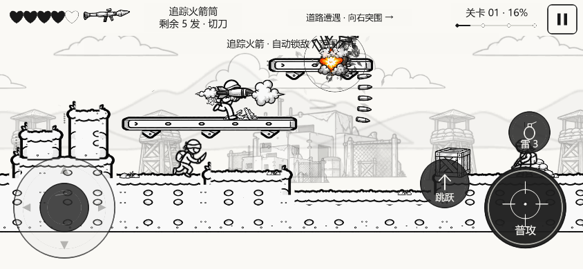
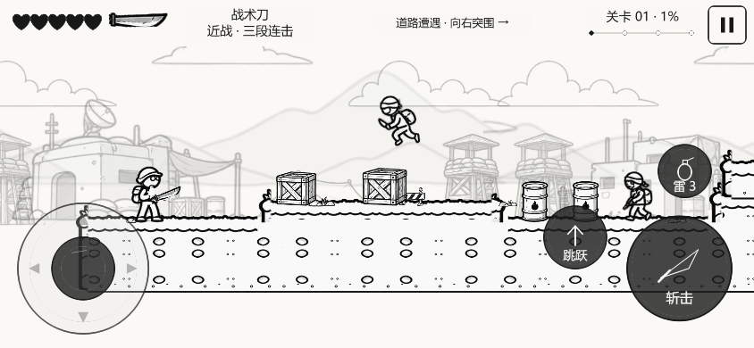
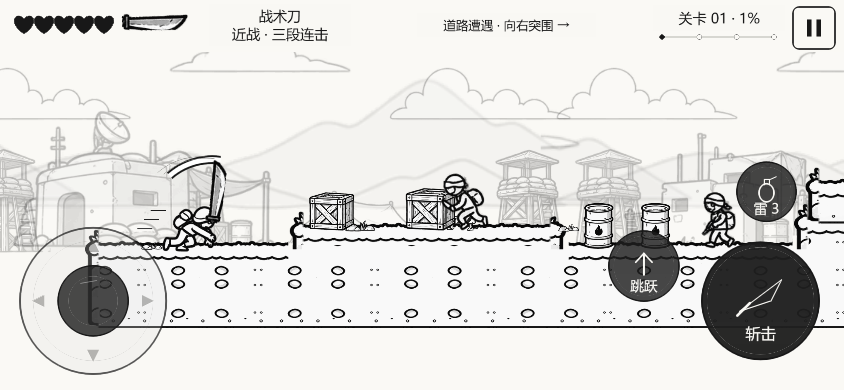
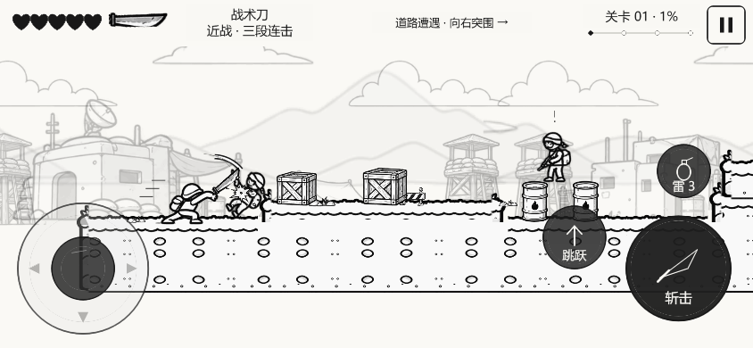

# V0.5.6：拼接、连贯换枪与三段刀击修复

日期：2026-10-19。在已有0.5.5工程上完成这轮修复，避免版本号回退。没有另起demo，也没有大规模生成新美术。

## 1. 地形拼接系统

上一版虽然已经拆块，但原图左右边缘并不相同，断面重复时会拼出半个圆点；高低地块还重复绘制了本应隐藏的内侧边框。现作以下处理：

- 从原图裁切并规范化可重复中段，左右边缘像素一致；跨边界的土层装饰以完整图案保留，身体纹理使用整个世界的相位，跨列、跨地块、跨渲染分块接得上。
- 连续地面使用同一断面底线；相邻地块重叠范围隐藏内部立面线，只显示高低差真正暴露的侧边。
- 金属横梁按左端/中段/右端拼接，底部支架使用独立、固定36单位宽度的小模块。加长平台只增加中段和支架数量。
- 图集边缘挤出从2像素增到4像素、保留8像素间隔；Cocos使用CLAMP_TO_EDGE和现有线性过滤。相邻块共用变换与纹理坐标基准，末块裁切不拉伸。
- 箱子、油桶、沙袋按源图宽高比显示，以实际底部锚点接触物理表面；取消原先额外向下偏移2单位的绘制。碰撞几何与掉落落点沿用原逻辑。

| 正式模块职责 | 对应实现 |
| --- | --- |
| top_left / top_mid / top_right | `tile.top.left / middle / right`，端头固定，中段周期重复 |
| top_single | 装配器组合左右端头和最短中段，独立块沿用同一规范 |
| body_left / body_mid / body_right | `tile.fill.left / middle / right`；相邻范围用mid隐藏内框 |
| pillar / column | 同一九分块装配器按高度重复body，不拉长整根立柱图 |
| edge_cap | `tile.bottom.*` 与顶部左右收口 |
| deco_overlay | 给定草边、石子/灌木覆盖层，随真实地面高度放置 |
| 金属浮台 | `tile.metal.left / middle / right` + `tile.metal.support` |

地面统一0.6像素密度、金属平台0.5；保留相机平滑跟随，未把不同块分别取整造成错缝。资源仍来自提供的可拼接地形图；远景与其他道具沿用既有素材。

## 2. 换枪空白与状态同步

检查确认资源原本就在开局预载，主要缺陷是：去枪裁切把胸口和手部一起清空；人物与武器系统各自保存武器类型；缺少动作时没有统一回退；射击后同一帧拾枪还可能播放新武器的开火声。

- 去枪身体补齐原胸部区域，保留源图手部及轮廓，不只留下零散白色手指。
- `WeaponSystem`为装备类型/弹药/冷却的唯一状态源，`PlayerController.weaponId`读取它，不再维护第二份有效状态。
- `WeaponPresentation`统一名称、图标、弹药文本、显示尺寸、枪口额外长度、弹道类型和音效类型。人物、HUD与发射系统消费同一描述；实际开火声使用`lastShot`。
- 所有当前武器、去枪身体与刀素材在开局创建缓存。切换只替换缓存帧；先检查资源有效再原子切换，失败则保留旧装备，拾取物不消失。
- 缺少可选动作时回退到蹲持或站射持枪帧，不清空Sprite。HUD明确使用居中锚点，避免刀图标覆盖文字。
- 切刀/回枪保存枪械剩余弹药和冷却，不能靠切换刷新火箭发射间隔。绘制帧采样结果见最终报告。

## 3. 独立刀武器与操作

刀是`WeaponId = knife`，不发射任何Projectile，不消耗弹药。作为随身近战武器可随时切换；现有拾取系统也接受刀类型。

- PC：**Q** 切刀/回到原枪，**J** 普攻，**L** 拔刀攻击。
- 手机：**轻触顶部武器栏** 切刀/回枪，长按原有普攻按钮连斩。按钮显示刀符号和“斩击”，不另占用右下触控布局。
- 枪械原有贴身快捷刀击保留为单次攻击；装备刀后使用完整连击。

| 动作状态 | 出手/演出 | 伤害与范围 | 表现 |
| --- | --- | --- | --- |
| stand_melee_attack_1 | 55ms前摇，260ms演出 | 4伤害，前向总可达约94 | 快速横斩，短前冲，刀弧 |
| stand_melee_attack_2 | 75ms前摇，300ms演出 | 4伤害，约105 | 反向斜斩，更大动势线 |
| stand_melee_attack_3 | 130ms前摇，430ms演出，额外140ms恢复 | 7伤害，约116 | 重劈，更粗刀光，强击退与普通兵小挑飞 |
| crouch_melee_attack | 单次低位斩，站立第一段节奏 | 4伤害，约78 | 低位刀弧、较短前冲 |
| jump_melee_attack | 单次空中斩 | 4伤害，第一段范围 | 使用既有跳跃身体帧与独立刀轨迹 |
| melee_hit | 玩家受击取消挥刀/缓存 | 不继续伤害 | 标准受击身体帧 |
| melee_combo_reset | 收招后420ms未续按、受击、切枪或重开 | 回到第一刀 | 清除连击阶段与缓冲 |

长按可连续打出三段；松开在当前刀收招后停止，窗口内再次按下可接下一段。刀图标来自既有刀兵素材的刀刃/刀柄裁切，身体动作复用提供的投掷、蹲下和跳跃帧。

## 4. 刀判定、命中与敌人反馈

- `MeleeGeometry`独立计算扫过的扇形/弧形与目标矩形相交。每帧推进角度，同一次挥刀对每个目标最多命中一次；不是短程子弹或枪械射线。
- 身体、刀刃、刀光和命中扇区共用`meleeHand`挂点。墙体可见性检查只负责遮挡；木箱可被刀击破，随后仍走原碰撞移除/补给流程。
- 前冲通过`LevelController.move`，被真实障碍阻挡，不可穿墙；蹲斩前冲更短，空中斩不额外拉动角色。
- 命中有材料火花、受击姿态、40ms停顿与轻震；第三刀65ms停顿、更强震屏。空挥和命中使用不同短音效。
- 普通兵/刀兵增加受击后退；第三刀可小幅挑飞。盾兵正面格挡并产生金属火花；绕后正常伤害。火箭兵的开火前摇会被打断。小坦克受击闪顿，大Boss保留攻击控制，不能被无限硬直锁住。

## 5. 截图与实测范围

浏览器截图使用真实键盘/触控/拾取，没有传送、改血量或删除敌人。最终测试计数、整关结果、逐帧切枪采样、构建大小见 `reports/v056-verification.json`；原始整套报告为`reports/v056-browser-results.json`。

- 严格类型检查与97/97逻辑测试通过。浏览器整套39/41通过；另两项仍等待7段音效，新增空挥/命中后应为9。仅修正这两个断言后复测2/2通过，未改游戏构建；原始失败与复测分别保留。因此41项均有当前构建通过证据。
- 真实按键完整关卡首轮69.93游戏秒通关，2生命、22击杀、两个Boss击败、无运行错误；保留活着的普通敌人进入Boss区并退回路线也通过。
- 16次Q/实际HUD触控切换，额外逐渲染帧采样70帧，0空白帧，HUD图标、人物持物、逻辑武器一致。
- 刀的真实浏览器操作观察到三段动作与40ms命中停顿，0子弹；第三刀伤害、挑飞、扇区遮挡、盾牌和Boss反馈另有逻辑测试。
- Web构建5,606,718字节；微信构建2,826,159字节，横屏和真实AppID检查通过。

## 6. 核心改动与剩余限制

- 地图：`normalize-terrain.py`、`prepare-comic-v055.py`、`TerrainTiles.ts`、`ComicLevelRenderer.ts`、`ComicObjectArt.ts`、图集与切片元数据。
- 装备：`WeaponSystem.ts`、`WeaponPresentation.ts`、`PlayerController.ts`、`PickupSystem.ts`、`ComicEquipment.ts`、`ComicAssets.ts`、`ComicActorArt.ts`、`HUDController.ts`。
- 近战：`MeleeSystem.ts`、`MeleeGeometry.ts`、`MeleePose.ts`、`CombatRenderer.ts`、`ComicCombatArt.ts`、`GameConfig.ts`、输入与音效适配。
- 回归：`v056-repairs.test.cjs`、`v056-repairs.spec.ts`，以及原整关、Boss、触控、武器和资源测试。

仍待补：专门的主角持刀/挥刀逐帧素材，目前是既有身体帧加独立刀与弧线；所有枪械的极端仰角手臂素材仍不完整。没有重新大规模生成资源。微信开发者工具、Android/iOS真机与持续60FPS未测。本轮交付本地Web和微信构建，没有上传、提交审核或正式发布。
