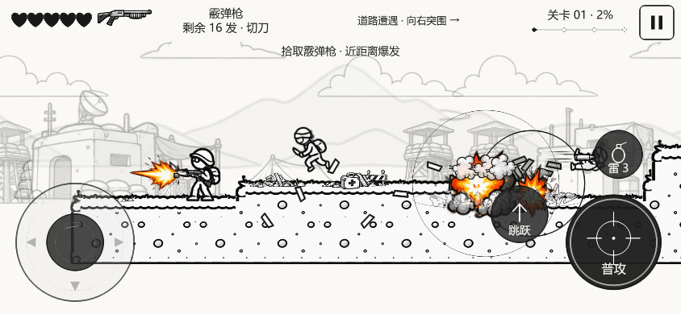
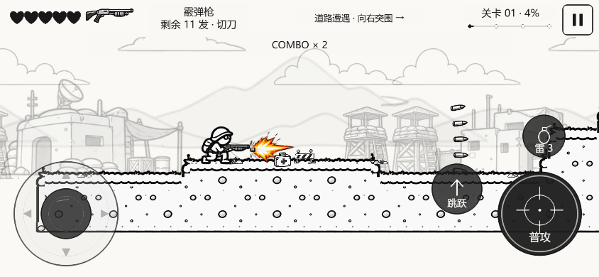
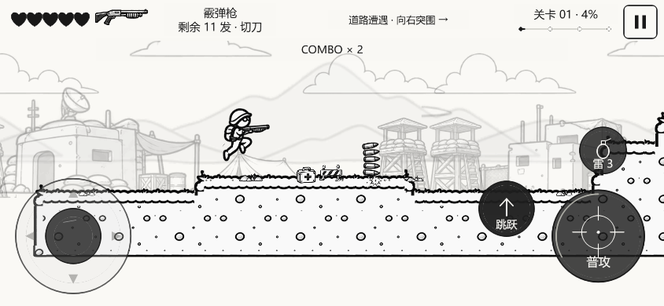

# V0.5.8：完整霰弹枪士兵与步枪弹速修正

日期：2026-10-29。仅修正这两项体验，沿用原有移动、触控、碰撞、拾取、刀与 Boss 流程。

## 资源接入

使用用户最新提供的 `霰弹枪士兵动作.png`，原图按原字节归档于 `art/source/v058`。1448×1086 RGBA，透明背景；SHA256及原图坐标、脚底/枪口锚点见 [清单](v058-manifest.json)，[逐帧预览](v058-preview.html)。运行 `scripts/prepare-comic-v058.py` 可重新裁切。

| 状态 | 完整人物帧数 | 用法 |
|---|---:|---|
| Idle / Run | 4 / 9 | 呼吸待机、按实际位移换腿 |
| Jump / Fall | 4 / 2 | 上升/下降，保留脚底锚点 |
| Crouch / Crouch Walk | 2 / 6 | 蹲姿和真实蹲行；蹲行开火仍换腿 |
| Stand Shoot / Run Shoot / Crouch Shoot | 3 / 2 / 4 | 完整持霰弹枪姿势，枪口由原图坐标驱动 |
| Hit / Death | 4 / 6 | 正常受击优先级和死亡序列 |
| Reload | 5 | 仅裁切归档，没有新增装填玩法 |

原图共57个人物（印刷的RUN8实际9、STAND SHOOT4实际5）。6个射击姿势与相邻人物/火焰重叠或火焰截断，排除后使用51个完整切片；没有重画人物或拆枪拼身体。切片仅清理低透明脏边和邻接碎片，保留有效源像素。最终2048×512索引PNG为141,058字节，4px边缘挤出、8px间隔。

霰弹枪启动时与其他图集一起预载；换枪直接选缓存整帧。`WeaponSystem`仍是装备和弹药唯一来源；切换前检查所有需要的动作和HUD图标。`ComicEquipment`不再为霰弹枪返回独立枪层/手掌层，消除旧去枪身体留下的透明空洞。

## 弹速

玩家普通步枪子弹从1100降为760单位/秒，降低约31%。射速0.14秒、伤害1、射程980不变；霰弹880、火箭460、敌方普通弹430不变。子弹仍按距离回收，没有因减速缩短射程。

## 验证与边界

- 严格类型检查和120项逻辑回归通过。包括完整关卡、Boss/返回路线、平台死角、火箭出膛、源像素/锚点、51帧覆盖、左右实际弹丸出膛、普通弹真实飞行/命中/回收。
- 正式Web构建的2项专项浏览器测试通过：实际步枪弹速760；真实键盘拾取霰弹枪，检查站/跑/蹲射、六帧蹲行开火、跳跃下落、8次切刀再返回。269个渲染采样无空白、无额外武器/手掌覆盖，HUD与人物一致，0运行错误。
- 专项测试使用844×390视口。最初用例在正常战斗中取姿势、冷却未完或尚未执行下一个逻辑帧时断言；测试改为沿真实路线返回已清理起点、等待实际发射/逻辑状态，并覆盖一个完整蹲行周期。没有调低敌人、关闭受伤或强行改游戏位置/状态。
- Web和微信小游戏正式构建成功。微信真机、真实手机多点触控/帧率未实测；本轮未上传微信。没有重跑浏览器整关，不能把旧整关截图作为本轮实测。
- 缺少专用蹲行射击、高角度瞄准和投雷图：蹲行用完整六帧加枪口效果，投雷复用先前提供的完整投掷动作；未重新拼装武器或肢体。

证据：[验收](../reports/v058-verification.json)、[浏览器结果](../reports/v058-browser-results.json)、[逐渲染帧记录](../reports/v058-shotgun.json)、[弹速实测](../reports/v058-rifle.json)。

