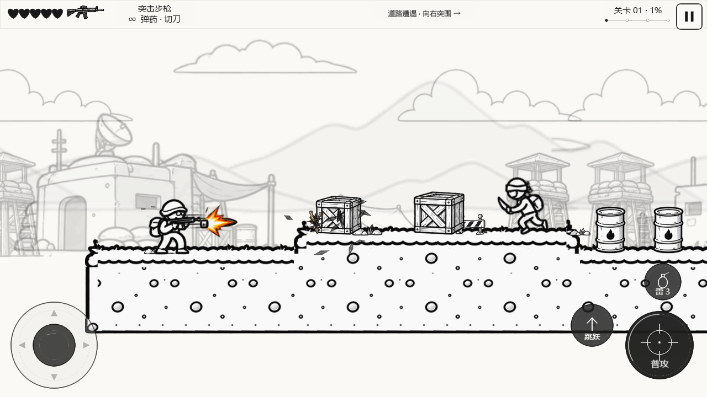
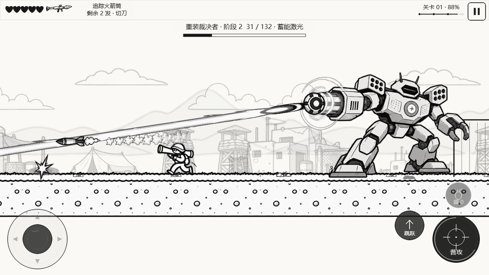
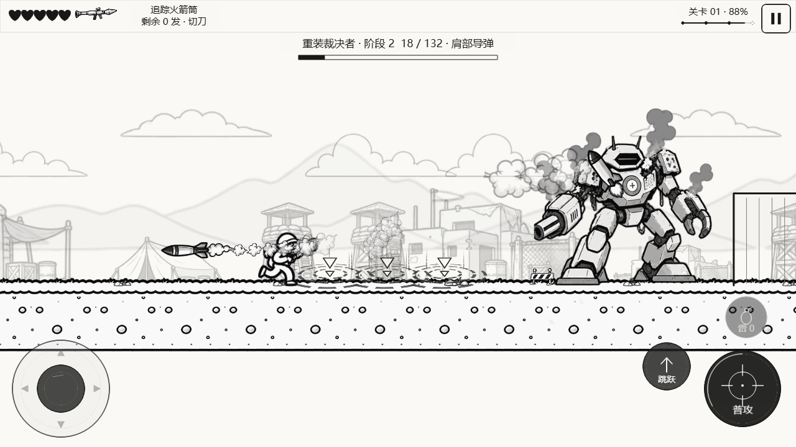
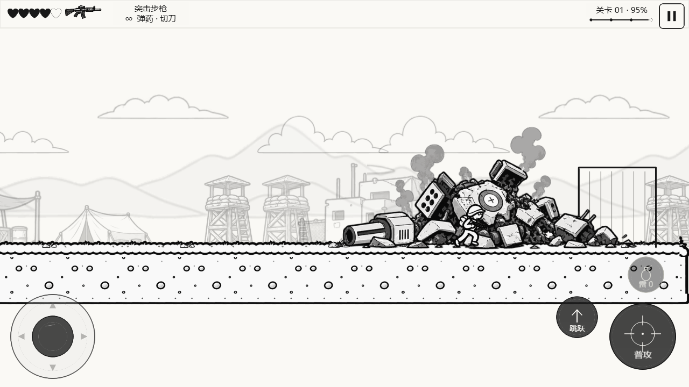

# V0.5.9：箱子破碎与机甲Boss

日期：2026-10-29。延续既有角色、操作、地图、拾取和关卡流程；使用本次提供的3张资源图。

## 箱子修复

原来的受损图带有散开的木板，比箱体本身宽；把整张受损图缩进原碰撞尺寸会让实际箱体变小。`crate.worn`又指向同一张受损图，第一次命中就会发生缩放变化。受击透明度还会让背景线条透进箱体，产生套叠观感。

现在木箱/悬挂箱在存活时一直使用**一张不透明完整箱体、固定宽高、固定底部锚点**；血量下降只增加裂纹、短促水平受击位移和木屑。归零后完整箱体直接退出，改为碎片/残渣演出，不经过缩小箱体阶段。原耐久、碰撞和补给规则保留；死亡当帧移除碰撞，只掉落一次。

## 资源

| 用户原图 | 实际接入 |
|---|---|
| 重装机甲Boss.png | 完整待机、两张抬脚姿势、重炮蓄能、受损冒烟、倒塌、残骸 |
| 机甲攻击与预警.png | 独立警告图标、地面预警环 |
| Boss弹体与特效.png | 机炮弹、重炮弹、导弹/尾焰、蓄能球、激光、落点标记、枪口闪光、命中、4阶段爆裂和烟雾 |

1448×1086 RGBA原图均按原字节归档于 `art/source/v059`。共23个切片，2048×1024运行图集约289 KiB，4px挤出、8px间隔。`prepare-comic-v059.py`可重复生成；清理邻接碎片/透明脏边，保留有效源像素。见 [资源清单与源像素锚点](v059-manifest.json)、[切片预览](v059-preview.html)。

机甲每次只画一张完整人物资源。所有姿势共用原图脚底、炮口、肩部发射口坐标，左右翻转与实际发射点同步。原几何机甲只保留为资源加载失败时的兼容后备，正常漫画模式不叠画。带有已离膛导弹的整幅姿势不拿来叠加真实发射物，以免出现两套导弹。

## 六种攻击

| 攻击 | 预警 / 实际判定 / 应对 |
|---|---|
| 重炮轰击（原有） | 锁定落点后发射重炮弧线弹；离开标记区域 |
| 踏地冲击（原有） | 抬脚与地面环，双向冲击波；跳跃躲避 |
| 瞄准连射（原有） | 虚线锁定方向，炮口连续发射；移动改变相对位置 |
| **蓄能激光（新增）** | 1.3秒蓄能（第二阶段约1.09秒），方向在预警时锁定；0.55秒射线从可见炮口射出，真实掩体截断，单束最多造成1次伤害；跳跃/离开锁定方向/掩体规避 |
| **肩部导弹（新增）** | 肩口先后发射，落点标记固定，带实体弹身和尾烟；第二阶段增加第三发；离开地面标记区域 |
| **扇形机炮（新增）** | 三条扇形预警线，连续2/3轮各3发实体子弹；弹速370单位/秒，保留躲避窗口 |

Boss血量132、小坦克血量42、两阶段阈值、原普通敌人/玩家数值保留。第二阶段继续缩短恢复并增加弹幕；原增援上限保留。死亡/玩家死亡/自由撤离都会清理活动激光，撤离不恢复Boss血量。HUD显示当前攻击及预警状态。

Boss镜头前视保持朝向当前交火目标，避免玩家闪避转身时把大型机甲裁到屏外。角色仍按实际朝向射击，离开战区后恢复普通方向前视；没有增加封路碰撞。

## 验证

- 严格类型检查、129项模型逻辑回归：箱子各血量阶段尺寸/碰撞/掉落，3张源图哈希/保留像素/脚底锚点，左右炮口，六种预警、激光命中/跳避/遮挡/清理，导弹落点、扇形弹道、Boss镜头与自由退路，以及原完整关卡回归。
- 正式Web专项检查包含真实键盘打碎第一屏箱子，以及从起点推进、小坦克、两阶段大Boss到出口的完整一局。当前验收结果、实际秒数/剩余生命和逐帧截图见 [验收报告](../reports/v059-verification.json)、[整关记录](../reports/v059-campaign.json)。
- 最终2项浏览器专项通过：90.83秒通关、剩4点生命、22击杀，六种预警及攻击均出现、两个阶段完整，0运行错误；箱子28个存活采样覆盖3/2/1血量，尺寸不变。镜头修正前也曾完整通关（111.18秒/2生命），最终报告只采用修正后结果。
- Web与微信小游戏构建通过；微信真机、开发者工具运行和真实手机帧率未测，本轮未上传微信。后续若上传，应重新核对源码/构建和上传回执。
- 本轮新增3种攻击；素材中的无人机、护盾、锥形光束只归档，未额外实现这些玩法。当前机甲使用7张完整姿势，尚非高帧数逐帧动画。

## 关键文件

`ObjectPresentation` / `ComicObjectArt` / `ObjectRenderer`：固定箱体和破坏演出。

`ColossusBoss` / `BossBeam` / `ColossusPresentation` / `MechFrames`：六种攻击、激光判定与整帧姿势/挂点。

`ComicAssets` / `ComicActorArt` / `ComicCombatArt` / `ProjectileManager`：预载图集、整帧机甲、独立弹体/激光/爆裂。

`GameSession` / `HUDController`：死亡清理、交火方向镜头、攻击提示和验收快照。

