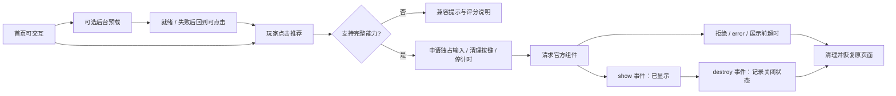

# 微信小游戏评价与推荐接入设计

> **2026-11-14 调研补充：** [推荐、评价与游戏圈内容串联](WECHAT-EVALUATION-GAMECLUB-RESEARCH-20261114.md)。推荐入口已接入；尚无已核验的评分编辑页直达方式或自动文字发帖接口，原生页面是否自带评价／同步内容需真机确认。本轮只调研，不改既有运行流程。

> **2026-11-13 / 1.0.7 修订优先：** 用户要求首次免费复活 1 次，之后分享邀请或推荐可继续获得，次数不限。分享按发起请求发放（取消也保留）；推荐按官方关闭返回已推荐状态发放，不能核验星级/文字评价。已实现并验证，详见 [1.0.7 记录](../../开发进度/迭代记录/V107-SOCIAL-REVIVAL.md)。以下保留原首版设计依据，其中不关联奖励、每关仅一次的产品规则已被本次修订替代；API 能力与真机验收边界继续有效。

[文档目录](../../doc/README.md) · [可点击布局稿](../原型/wechat-evaluation.html)

日期：2026-11-13。状态：**P0 首页固定入口已接入；微信真机验收待完成；P1 结算提示未启用**。当前工作区 Cocos Creator 3.8.8 / `ReleaseConfig.version = 1.0.6`，开放第一、二关。实际交付与验证见[接入记录](../../开发进度/迭代记录/WECHAT-RECOMMENDATION-P0.md)；版本号不代表线上已发布。

## 1. 产品结论

先接入首页的固定 **「推荐游戏」** 入口；玩家点击后打开微信官方推荐组件。后续再增加通关结算的可关闭轻提示。推荐自愿，不关联奖励，不影响继续下一关、重玩、纪录或分享。

**评分与推荐是两个入口。** 用户提供的官方正文与截图说明：星级打分、文字评价在微信的「评分主页」进行，可从搜索结果或小游戏更多面板进入；本文接入的 PageManager + 指定 openlink 打开的是「推荐组件」。因此按钮不叫「五星好评」「去打分」，也不将推荐状态显示为「评价成功」。这份文档未提供直接拉起星级评价编辑页的接口，不规划猜测的跳转方法。

依据：[微信开放文档：评价与推荐](https://developers.weixin.qq.com/minigame/dev/guide/open-ability/game-evaluate.html)。本轮依据用户粘贴的完整正文和配图核对；自动浏览正文受到安全规则限制。下文将官方已说明的行为、产品选择和待真机验证事项分别标明。

## 2. 官方能力与边界

| 项目 | 文档依据 / 设计含义 |
| --- | --- |
| 组件创建 | `wx.createPageManager()`；调用前检查是否存在 |
| 预加载 | `pageManager.load({ openlink })`，不应阻塞开始游戏 |
| 展示 | `pageManager.show({ openlink })`；官方说明未预加载会先加载；最佳实践另展示了加载后 `show()` 的用法 |
| 销毁 | `pageManager.destroy()`；实例寿命、关闭后是否复用需真机核验，首版设计关闭后释放引用、下次重建 |
| 监听 | `pageManager.on('ready' / 'show' / 'destroy' / 'error', handler)` |
| 版本 | 文档明确 **事件监听及 `destroy.isRecommended` 从基础库 3.8.6 开始支持**；不能写成 `createPageManager` 本身一定从 3.8.6 才出现 |
| 关闭结果 | `destroy` 事件的布尔值 `isRecommended` 表示关闭时的推荐状态；不等于本次新推荐、不等于星级评分、不等于分享消息已送达 |
| 错误 | 指南提供 `errCode` / `errMsg`；后续核对官方类型定义补足通用错误码。首版仅保留失败阶段及数字错误码，界面用统一可恢复提示，不猜测账号资格 |
| 激励 | 官方不提倡用道具奖励刺激推荐；本项目不设置推荐奖励、任务、通关门槛或预选星级 |

官方给定的公开组件常量（不是本游戏 AppID，也不是登录凭据）：

```text
TWFRCqV5WeM2AkMXhKwJ03MhfPOieJfAsvXKUbWvQFQtLyyA5etMPabBehga950uzfZcH3Vi3QeEh41xRGEVFw
```

实施时以常量集中保存，不从分享 query、用户输入或服务器下发任意 openlink。当前资料未要求为这个官方常量另行申请专属链接；账号可用性仍在真实微信环境验证。本能力不以好友榜授权作为前置条件；不在此流程读取头像、昵称或好友关系。

## 3. 首页布局：首版 P0

保留现有漫画封面、黑白按钮和主按钮层级。底部「纪录与好友榜」一行拆成两个入口，左侧使用短名称「纪录榜」，打开的仍是完整「纪录与好友榜」页面；右侧是「推荐游戏」。新增热区在原有左侧操作列内，不遮住右侧机甲。

```text
线条突围                    原有主角与机甲封面
冲出重围。

[          开始突围 →          ]  主按钮
[     游戏圈    ] [   分享游戏   ]
[     纪录榜    ] [   推荐游戏   ]  新增入口
```

- 「推荐游戏」点击后直接请求官方组件，不先询问玩家喜欢还是不喜欢，不经过好评筛选。
- 入口不加红点、闪烁、摇晃、倒计时或积分说明。
- 首版不在暂停菜单再挤一行；原暂停、战斗、失败、好友榜页面不自动展示推荐组件。
- 原生组件显示期间隔离下层游戏输入、隐藏游戏圈原生按钮；关闭回首页。返回动作不自动开始游戏。
- Web 生产版不显示微信推荐入口；设计原型中的「Web」仅用于演示这条隐藏规则。
- 低版本微信仍可保留入口，点击显示可关闭的兼容提示与评分路径说明，不尝试创建不可靠的组件。

布局约束：1280×720 作为设计参考，但点击目标按设备逻辑像素检查。667×375、844×390、932×430 横屏下，新入口和相邻控件目标高度至少 44，间距至少 8；必要时调整左侧整列的间距和副标题占用，不能只把设计稿整体缩小。避让刘海、底部手势区和右上角微信胶囊。竖屏按当前游戏横屏策略隐藏操作入口及热区。

## 4. 通关轻提示：后续 P1

在 P0 微信真机验收通过后，再启用可独立关闭的结算提示。第一、二关共用规则，第三关不因新入口变为可达。

```text
┌ 喜欢这次突围？               × ┐    ┌ 突围成功               ┐
│ 让更多朋友发现《线条突围》。    │    │ 用时 / 纪录 / 战果      │
│ [ 推荐游戏 ]                  │    │ [进入第二关 / 返回首页] │
└──────────────────────────────┘    │ [重玩] [首页]          │
              原有欢呼角色           │ [纪录榜] [分享挑战]    │
                                    └────────────────────────┘
```

推荐条放在结算画面左上方空白区，保留角色欢呼区域和右侧成绩卡；小屏空间不足时不显示推荐条，固定首页入口仍保留。主按钮、成绩、纪录榜、分享挑战的优先级不变。

候选规则（**项目设计参数，不是微信平台频控**）：

1. 仅在正式闯关完成第一或第二关，且 `victory.resultsReady` 已成立后等待 0.8 秒；这段时间离开结算即取消，不带到下一关。
2. 当前启动会话最多出现一次；两次曝光至少间隔 7×24 小时。曝光时即记录时间，点击关闭、点击继续、打开好友榜或分享，都不立即补弹。
3. 最近一次收到有效 `isRecommended === true` 后，停止主动提示；首页固定入口仍可使用。保存的是最近一次观察及提示抑制状态，不宣称账号永久已推荐。后续可信 `false` 更新该观察，但仍遵守冷却。
4. `false` 表示关闭时未推荐；未返回字段或异常为未知。两者都不弹追问、不催促重试、不扣奖励。
5. 不以失败、死亡、受伤、连续卡关或首次进入游戏触发，不在 Boss 倒塌、镜头推近、欢呼和数字入场中插入。
6. 轻提示本身无强制等待；玩家可以立即进入下一关。只有玩家点击「推荐游戏」才调用 `show`。

本机频控只能约束这份本地存档，清数据、换设备、切微信账号不能保证同步；首版不为此引入用户标识或服务器。存储读取失败时，本次会话保守关闭主动提示，固定入口仍可用。

## 5. 文案与返回行为

| 状态 | 玩家看到的内容 | 行为 |
| --- | --- | --- |
| 固定入口 | 推荐游戏 | 打开官方推荐组件 |
| 点击后等待 | 正在打开… | 按钮禁用，短时隔离下层输入，保留可取消等待 |
| 组件已显示 | 微信自己的推荐界面 | 本项目不仿制星级表单、不替玩家提交 |
| 关闭且返回 true | 感谢推荐，继续突围！ | 短提示一次，回原页面；不发奖励 |
| 关闭且返回 false / 缺字段 | 无额外提示 | 安静回原页面，不宣布成功 |
| 组件失败 | 暂时无法打开，请稍后再试。 | 恢复原界面，只由玩家再次点击重试 |
| 低版本 | 当前微信暂不支持此入口，可更新微信后重试。 | 可关闭；提供「如何写评价」说明 |
| 评分说明 | 可从微信小游戏更多面板中的体验评价入口，或微信搜索结果中的评分入口，进入评分主页后写评价。入口样式以当前微信为准。 | 仅说明官方已给出的路径，不假设代码可以自动打开评分编辑页 |

`true` 是关闭时的状态。如果用户本来就推荐过，也可能返回 true，因此本机提示可以表示感谢，统计不命名为「新增推荐成功」。首次打开前，不把历史缓存渲染成实时「已推荐」标识。

## 6. 工程设计

### 模块与现有接点

| 位置 | 计划修改 |
| --- | --- |
| 新增 `源码/assets/scripts/platform/RecommendationBridge.ts` | 封装 PageManager、能力判断、预载、单次请求、事件回调、失败清理；不导入游戏战斗逻辑 |
| `源码/assets/scripts/platform/PlatformAdapter.ts` | 持有推荐桥，沿用平台识别、存储适配；不要将好友榜的 `canUpload()` 直接作为组件展示条件 |
| `源码/assets/scripts/platform/PlatformBridge.ts` | 生命周期订阅统一管理；销毁推荐桥，避免独立重复注册全局前后台监听 |
| `源码/assets/scripts/GameManager.ts` | 开关组件时停计时、清输入、隐藏原生游戏圈；给开始/继续/切关/纪录页/邀请展示及 `lateUpdate` 加统一外部页面占用判断 |
| `源码/assets/scripts/ui/TitlePoster.ts` | 首页二列次级入口；仍复用 `ControlArt` 的现有图片按钮 |
| `源码/assets/scripts/ui/HUDController.ts` | P1 监听结算可交互状态，绘制可关闭推荐条；不改 `VictorySequence` 时长 |
| P1 独立频控存储 | 版本化小结构，不写入竞速纪录或好友云存储 |

当前 `GameManager.update()` 每帧重新计算个人计时启停，`lateUpdate()` 每帧同步原生游戏圈按钮。**只在点击时停表和调用一次 `hide()` 不够**：推荐加载或展示期间，也必须在这些持续更新路径里排除；否则下一帧可能重新计时或重新显示原生热区。已有 `CocosInputAdapter.setModal()` 只管理一个模态所有者，应复用现有输入规则，并阻止推荐与纪录页同时打开，不能相互覆盖 modal 后再随意清空。

### 能力门槛

首版选择基础库 **≥3.8.6** 且存在 `wx.createPageManager`、实例具备 `load/show/destroy/on` 的完整路径；这是项目为可靠关闭事件设定的保守门槛，并非对创建接口最早版本的结论。基础库版本按数字段比较，不能用字符串比较，也不能与微信客户端版本混用。版本未知、能力缺失或创建异常均走兼容说明。

实施时补充核对了[微信官方小游戏类型定义](https://github.com/wechat-miniprogram/minigame-api-typings/blob/master/types/wx/lib.wx.api.d.ts)：`load/show` 返回 Promise，`destroy()` 返回 void，`off(eventName, callback)` 存在；通用 PageManager 方法标注始于 3.6.7，推荐指南的 3.8.6 门槛仍单独保留。实现可选调用 `off` 并使用实例身份隔离迟到事件。关闭与手动销毁的真实事件次序仍需手机验证。项目最低运行基础库未全局提升。

### 生命周期与异步处理



- 首页就绪后的空闲时段预载；预载不加遮罩、不改变会话状态、不阻塞资源加载，也不主动展示。预载失败不弹错误，只记录供诊断。
- 一个桥只保留一个有效实例、一个加载任务和一个展示请求；监听先注册再加载。连点共享请求，不重复创建。
- 预载已好时，点击立即 `show({ openlink })`。实现选择：预载尚未完成时销毁旧预载实例，在同一次点击内创建新实例并由 `show({ openlink })` 承担加载；不并发重入同一实例的 `load/show`，不跨异步等待再发起展示。该路径已通过宿主模拟，微信实例销毁和点击兼容仍需真机核对。
- `requestId` / 实例代次保护迟到回调；用户离开页面、取消等待或销毁后，旧回调不能再打开组件、弹成功提示或重新改变游戏状态。
- 展示前等待上限初拟 8 秒；仅用于请求无响应恢复。清理或取消请求后再解锁，不能让迟到组件与恢复的战斗重叠。若宿主销毁无法确认，保持安全暂停并提供返回首页恢复路径，等待真机确定可行处理。
- 收到 `show` 后停止展示前超时，不因玩家阅读时间长而自动关页。`show()` resolved、`ready`、返回前台都不代表完成推荐。
- 外部页面期间 `externalUiBusy` 独占交互，清空当前触摸/按键、暂停模拟和计时，隐藏原生游戏圈；邀请回流先排队。关闭后不自动开始/继续战斗，只恢复原首页或结算页面；未来从暂停入口进入时仍保持暂停。
- `destroy` 事件表示这次页面寿命结束：更新合法布尔观察、清理引用与锁。桥主动清理、退出场景时标记原因；即使宿主随后发同名事件，也不当作新的玩家推荐行为。幂等清理，避免递归 `destroy()`。
- 用户评分、改评分和撤销推荐由微信负责。首版不读总评分、不读评价正文、不创建自有评分表。

### 可观测性与存储

P0 只用现有本地诊断方式记录：入口来源（首页/结算）、请求、show、关闭状态 true/false/unknown、失败阶段及错误码。无真实用户标识，不上传完整原始错误对象。不要以「回到前台」记推荐完成，也不把 `true` 次数当新增推荐人数；此接口不能算出准确新增转化。

P1 本机结构建议：`schema`、`lastPromptShownAt`、`lastKnownRecommended`、`observedAt`；本次启动是否已提示仅在内存保留。使用独立键 `breakout.recommendation.v1.<environment>`，时间使用墙上时钟做冷却，与竞速计时完全分离。时钟异常保守抑制主动提示；频控失败不影响纪录存储。

## 7. 分阶段实施与验收

| 阶段 | 交付 | 通过条件 |
| --- | --- | --- |
| P0-A | 推荐桥、能力判断、首页入口、错误/兼容说明 | 类型检查；模拟实际 UI 点击链、重复点击、加载失败、迟到事件、关闭的三态、退出清理 |
| P0-B | 微信本地测试包 | 新旧基础库、iOS/Android 真机点开和关闭组件；横屏/旋屏/后台恢复不误操作；推荐状态语义确认 |
| P1 | 结算轻提示、本机频控、入口曝光记录 | 第一/二关 resultsReady 后出现；进入下一关不被延迟打断；关闭/已推荐/冷却/存储失败均正确 |
| 后续复盘 | 根据真实使用反馈调整位置或频率 | 使用真实组件曝光与关闭状态，不通过奖励、强制等待或评分筛选提升指标 |

专项验收至少包含：

- 首页首次进入不自动弹组件；点击主按钮和相邻纪录榜不误触推荐。
- 连点推荐仅一个有效页面；预载进行中点击、预载失败后再点击均可恢复。
- 模拟 show 成功但关闭 false / undefined；不能显示推荐成功或发奖励。true 只表示关闭时状态。
- 异常、超时、销毁、场景切换及后台返回均无未处理拒绝和残留输入；前台返回不提前解锁仍在显示的组件。
- 推荐页期间纪录页、分享、原生游戏圈和开始/继续按钮不响应；回来后原成绩、关卡和暂停状态保持。
- 不支持接口、低于 3.8.6、版本未知、`on` 缺失、Web 环境按约定降级，不留下空白遮罩。
- 667×375、844×390、932×430、1280×720 和竖屏恢复，检查点击面积、安全区、漫画封面与结算主按钮。
- P1 频控跨启动、true 后抑制、false 后冷却、存储失败、时钟倒退；主动展示与主动点击分别计数。
- 第一关连续进入第二关，第二关返回首页；新流程不开放第三关，不改战斗数值和已认可体验锚点。

浏览器原型和模拟接收方只验证布局与分支，不等于微信原生组件验收。真机验证使用测试账号，不由自动化替用户进行真实推荐、打星或发表评论。

## 8. 本轮交付与限制

- P0 已实现独立 `RecommendationBridge`、首页两列按钮、`RecommendationPanel` 等待/异常/兼容说明、三态关闭处理、输入/计时/游戏圈隔离与邀请排队。
- 低版本、缺接口、预载未完成或失败、重复点击、取消、8 秒展示前超时、销毁异常恢复均纳入验证。横屏入口、竖屏等待页复用现有按钮美术。
- 只有玩家点击首页入口才打开原生组件；不加奖励、不主动弹窗、不存储评分/好友身份。P1 频控和结算提示保持后续阶段。
- [布局原型](../原型/wechat-evaluation.html)仍用于说明 P1 候选方案，不能视为运行版本已经启用 P1。
- 当前源码与本地构建沿用工作区 1.0.6 标识，包含工作区既有复活/选关改动；本任务未再次改版本号。最终包、测试及尚未完成的微信开发者工具/手机验收见接入记录。
