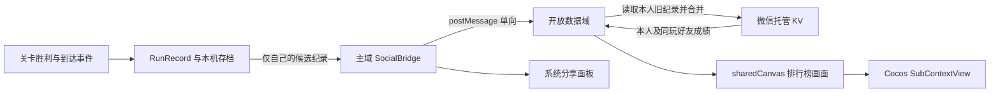

# 微信好友、排行榜与分享邀请接入方案

调研日期：2026-11-13。基于当前工作区 **1.0.2 / Cocos Creator 3.8.8 / 正式开放两关**。本轮交付为调研与设计，未接入功能、修改玩法、构建或上传游戏。

后续进展：同日已按 P0 接入 **1.0.3**，实现、验证与局限见 [首版接入记录](../../开发进度/迭代记录/V103-WECHAT-SOCIAL.md)。下文保留原方案；动态横屏画布接入采用公开纹理接口实现，具体原因见首版记录。真实微信验收、P1 定向邀请与服务端能力仍未完成。

## 1. 推荐方案

先实现「好友闯关进度 + 每关最快用时 + 分享挑战」的小闭环，再接「定向邀请 + 群榜 + 服务端邀请归因」。首版使用微信托管数据和开放数据域，不必为一个好友榜先搭完整服务器。

| 功能 | 玩家看到什么 | 推荐阶段 |
| --- | --- | --- |
| 好友列表 / 进度榜 | 微信同玩好友、头像昵称、闯到第几关、已通几关 | P0 |
| 第一关 / 第二关竞速榜 | 同一关的历史最快通关秒数、自己名次 | P0 |
| 结算战绩分享 | 「第一关 123.4 秒，你能更快吗？」卡片 | P0 |
| 邀请一起玩 | 用户选择微信好友或群发送游戏卡片 | P0 |
| 指定好友挑战 / 候选好友邀请 | 榜单行内挑战；微信推荐的未注册好友 | P1 |
| 群榜 | 从群卡片进入后查看该群同玩成员成绩 | P1 |
| 谁邀请了谁、有效邀请人数 | 后台验证的接受邀请、开始游玩、完成第一关 | P1，需要服务端 |
| 全服榜、周榜、连续两关总用时 | 独立榜单和独立规则 | P2 |

首版保留现有难度、移动、战斗、两关衔接和美术。这里只新增记录与社交入口，不把好友授权、分享或邀请作为继续游戏的条件。

## 2. 微信实际上开放哪些能力

### 2.1 好友不是完整通讯录

`wx.getFriendCloudStorage` 返回**同玩好友的托管成绩**，只能在开放数据域调用，并需要 `scope.WxFriendInteraction` 授权。新加的微信好友可能有最多约两小时的数据可见延迟。只有写过托管数据的玩家才会进入这套同玩关系数据，因此不能仅在通关之后才首次登记，否则玩了但尚未通关的人可能不出现。[好友成绩 API](https://developers.weixin.qq.com/minigame/dev/api/open-api/data/wx.getFriendCloudStorage.html)、[关系链指南](https://developers.weixin.qq.com/minigame/dev/guide/open-ability/open-data.html)

产品名称用「好友榜」「一起玩的好友」。不承诺全部微信好友、在线状态、微信号、手机号，也不设计任意搜索微信通讯录的功能。对未上传有效时间的好友显示「暂无通关纪录」，不能当成 0 秒。

### 2.2 邀请候选名单

`wx.getPotentialFriendList` 可以取得可能感兴趣、尚未注册的好友，每次最多 5 位，需要同一朋友信息授权，且只在开放数据域可用。这是推荐名单，不能靠不停刷新枚举完整通讯录。`wx.shareMessageToFriend` 可在该域内向指定好友发起游戏分享。[候选好友](https://developers.weixin.qq.com/minigame/dev/api/open-api/data/wx.getPotentialFriendList.html)、[定向分享](https://developers.weixin.qq.com/minigame/dev/api/open-api/data/wx.shareMessageToFriend.html)

先让普通「邀请一起玩」可用；候选名单为空、授权拒绝或接口不支持时，仍可使用系统分享面板。

### 2.3 新的同玩互动好友接口，保留为后续选项

当前官方另有基础库 **3.16.2** 起的 `wx.getRelationFriendList`，需要 **`scope.interactedUserInfo`**，返回加密的同玩互动好友 OpenID 列表或 cloudID。它与旧的好友托管排行榜不是同一个接口，也不是完整通讯录。可作为后续服务端好友系统的入口，不能用来声称可以任意导出开放数据域的数据。[官方接口](https://developers.weixin.qq.com/minigame/dev/api/open-api/data/wx.getRelationFriendList.html)

首版不增加这项额外授权和基础库要求。该页面顶部出现了 `scope.scope.interactedUserInfo` 的重复前缀，正文、示例及官方类型定义均使用 `scope.interactedUserInfo`；实现按后者并真机核验。

### 2.4 群榜与朋友圈

群榜使用开放数据域的 `wx.getGroupCloudStorage`，有群进入场景限制。当前接口支持 `shareTicket`，也支持基础库 3.8.8 起的 `groupid`；官方建议使用后者。`wx.getGroupEnterInfo` 提供的是加密数据 / cloudID，不能直接读取 `res.opengid`，需服务端解密或云调用后取得群标识。[群成绩](https://developers.weixin.qq.com/minigame/dev/api/open-api/data/wx.getGroupCloudStorage.html)、[群进入信息](https://developers.weixin.qq.com/minigame/dev/api/open-api/group/wx.getGroupEnterInfo.html)

P1 优先验证 `groupid` 路线；旧版本可用有效 `shareTicket` 降级。若启用 `withShareTicket`，会影响分享目标多选及卡片二次转发，不能为了普通好友分享默认全局开启。[转发指南](https://developers.weixin.qq.com/minigame/dev/guide/open-ability/share/share.html)

朋友圈另列兼容项。当前 `wx.onShareTimeline` 官方页面仍标注 Beta、暂只支持 Android，不能承诺 iPhone 同等支持。[朋友圈接口](https://developers.weixin.qq.com/minigame/dev/api/share/wx.onShareTimeline.html)

## 3. 当前项目已有能力与缺口

| 当前入口 | 已确认情况 | 接入时的工作 |
| --- | --- | --- |
| [ReleaseConfig.ts](../../源码/assets/scripts/core/ReleaseConfig.ts) | 版本 1.0.2，`lastChapter: 2` | 所有榜单、分享跳转受正式关卡范围限制 |
| [ShareBridge.ts](../../源码/assets/scripts/platform/ShareBridge.ts) | 已有主动分享、菜单分享；固定标题和 `from=share` | 扩展卡片类型、明确图片和分享参数 |
| [PlatformBridge.ts](../../源码/assets/scripts/platform/PlatformBridge.ts) | 已处理引擎前后台事件，未解析微信回流参数 | 单独接收冷启动与 `wx.onShow` 的 query |
| [GameManager.ts](../../源码/assets/scripts/GameManager.ts) | 分享前清理输入、暂停；固定步长推进游戏 | 接入成绩事件、真实时钟和社交弹层 |
| [GameSession.ts](../../源码/assets/scripts/core/GameSession.ts) | 第一关用模拟 `time`，Boss 死亡触发胜利演出 | 胜利触发点固化一次成绩 |
| [OceanSession.ts](../../源码/assets/scripts/ocean/OceanSession.ts) | 有 `time` / `clearTime`，入海过场也会推进模拟时间 | 以首次可操作和胜利事件定义计时边界 |
| [HUDController.ts](../../源码/assets/scripts/ui/HUDController.ts) | 结算显示整数秒；没有榜单和个人最佳纪录 | 新增好友榜弹层、最佳成绩和战绩分享 |
| [微信构建配置](../../源码/build-config/wechatgame.json) | 没有开放数据域配置；模板目录只有 Web 模板 | 增加微信子域源码和可重复构建检查 |

定向检索 `源码/assets/scripts` 的核心与平台层，尚未发现成绩持久化、微信登录服务、好友榜或邀请归因实现。现有分享和游戏圈可复用；游戏圈不是好友列表接口。

## 4. 「多少关、多少秒」的产品规则

### 4.1 进度榜

分别保存：

- **最远到达关卡**：正常游戏流程中实际进入、资源加载完成的最高关卡。
- **最高连续通关关卡**：从第一关开始连续完成的最高关卡。进入第二关不能写成通关第二关。
- **每关最快完成时间**：只取有效胜利记录；失败、还在游玩、死亡演出没有通关时间。

当前只有两关，显示规则为：

| 状态 | 展示 |
| --- | --- |
| 第一关中途失败 | 闯至第 1 关 · 已通 0 关 |
| 第一关通过，尚未进入第二关 | 已通第 1 关 |
| 已进入第二关，未打过潜艇 Boss | 闯至第 2 关 · 已通 1 关 |
| 两关都完成 | 已通关 2 关 · 当前全部完成 |

排序按「最高连续通关关卡降序 → 最远到达关卡降序」。相同进度并列，采用 `1、1、3` 的名次方式；稳定显示顺序可在开放数据域内按 OpenID 排列，但不把它当额外竞技成绩。首版不以死亡前生存时长排序，也不以横向坐标冒充关卡完成百分比。

### 4.2 单关竞速榜

第一关和第二关各一页，只比较**同关卡、同规则版本、正常模式**的历史最快有效时间。内部以整数毫秒保存，显示 `123.4 秒`，按毫秒升序排列；精确相同的成绩并列。显示保留一位小数只是可读性选择，不宣称帧内毫秒级判定精度。

未通关玩家保留在进度榜，竞速榜标「未上榜」。成绩键缺失、JSON 损坏、负数、0、非有限数、错误规则版本均不进入竞速排名。

**不把各关不同场次的最佳时间相加，称作连续通关总用时。** 如后续做连续两关榜，需独立 `campaignAttemptId`，同一次从第一关出发并完成两关才有效；失败、重开或中途换路线使本次连续挑战失效，但仍可保留各关独立纪录。

### 4.3 计时口径：有效操作期间的真实经过时间

建议新增独立 `RunClock`，旧 `session.time` 继续驱动战斗和动画，不用于新竞速榜。当前 `GameManager` 对大帧差截到 0.1 秒，受击停顿也会跳过模拟推进，直接拿模拟秒数排名会使不同设备和受击次数影响比较。

| 情况 | 竞速时钟处理 |
| --- | --- |
| 第一关从首页开始 | 角色首次可正常操作时开始 |
| 第二关装载、走近海边、换装入海 | 不计入；首次恢复游泳操作时开始；跳过过场与完整观看一致 |
| 正常操作、玩家发呆、掉帧、受击短暂停顿 | 计入真实经过时间，不套模拟时间上限 |
| 主动暂停、后台、分享面板、游戏圈、竖屏暂停、章节加载 | 暂停计时；回到游戏并主动继续时恢复 |
| 最终 Boss 被有效击败且玩家存活 | 同步停止时钟，生成不可变结算记录 |
| Boss 坍塌、欢呼、结算数值滚动、看榜 | 不计入 |
| 死亡 / 重开 | 本次不产生通关成绩；下一局重新计时 |

时钟适配器统一输出毫秒。浏览器的 `performance.now()` 与微信小游戏 `wx.getPerformance().now()` 不可直接混用，后者当前文档标注为**微秒**，须做单位归一并验证 1 秒标定；Cocos 包装层若已换算不能再除一次。不要用可被系统改时影响的墙上时间作为唯一竞速时钟。[微信时间 API](https://developers.weixin.qq.com/minigame/dev/api/base/performance/Performance.now.html)

用开始 / 暂停 / 恢复 / 胜利事件累计时间段，不能因为瞬时 `controlEnabled=false` 就停止：例如受击硬直仍计时。胜利发生在固定步长的某个子步时，仅结算一次，并记录该帧采样边界。异常时钟回退或无法确认单位时，保留本机成绩但取消竞速上传。

计时规则作为独立 `rulesVersion`。现有 1.0.2 没有历史可信成绩可迁移，不从旧试玩报告、截图或 `session.time` 补造排行榜。

## 5. 页面与玩家流程

### 5.1 首页、暂停与结算

- 首页：保留「开始突围」，增加次级「好友榜」；现有「分享游戏」可改为更明确的「邀请一起玩」。
- 暂停：可打开同一榜单；关闭榜单回到暂停页，保持手动继续的现有行为。
- 通关结算：主要按钮仍是继续下一关 / 返回首页。增加「本次 123.4 秒」「个人最佳 120.8 秒」「分享战绩」「好友榜」。
- 失败结算：主要按钮仍是重试；可分享「闯至第 2 关」，不能使用“通关”文案。

沿用黑白漫画底板、字号体系和安全区，不在战斗 HUD 中持续显示整张榜。弹层开启时清理摇杆 / 开火触摸，隐藏原生游戏圈透明按钮，防止底层点击穿透。

### 5.2 横屏榜单结构示意

以下均为示例信息，不是真实好友数据或最终美术。

```text
好友榜                                             关闭
[闯关进度]  [第一关竞速]  [第二关竞速]

名次   头像 昵称          进度 / 当前页最快用时
 1          好友 A       已通 2 关
 2          好友 B       闯至第 2 关 · 已通 1 关
 3          我           已通第 1 关
 4          好友 C       闯至第 1 关 · 未通关

我的纪录与名次固定在底部              [邀请一起玩]
```

进度页可在行下显示两关个人最佳摘要；竞速页只突出当前关的秒数。自己的云端纪录、名次、与上一名差距均在开放数据域绘制。主游戏结算只显示自己本机的本次 / 最佳，不读取好友资料。

列表滚动区与底部操作区分离；小横屏优先保留昵称、进度和成绩，长昵称截断，失败头像使用已有头像占位资源。排行榜关闭后停止绘制更新；旋转、尺寸变化和 DPR 变化都重新校正视窗。

### 5.3 必备状态

| 状态 | 玩家看到什么 |
| --- | --- |
| 尚未授权 | 说明用于展示同玩好友与排行；「查看好友榜」「先继续玩」 |
| 拒绝授权 | 个人本机纪录仍可看；用户主动点按钮才再次引导设置 |
| 首次加载 | 稳定的加载提示，不弹出空白榜单 |
| 没有好友成绩 | 「还没有好友成绩，邀请朋友来挑战」；不填充假好友 |
| 成绩尚未同步 | 本机结算可用，榜单内部显示待同步 / 重试 |
| 加载失败或离线 | 本次仍可玩；显示本机纪录，云榜标明不可用 |
| 接口不支持 | 简洁提示更新微信；保留普通分享 |
| 分享取消或返回 | 保持原页面 / 暂停，不显示“邀请成功” |
| 从邀请进入且已有一局进行中 | 暂存邀请，在安全菜单点确认；不自动重开或丢弃当前局 |

## 6. P0 技术接法：本机纪录 + 微信托管 + 开放数据域



### 6.1 数据归属与单向通信

开放数据域不能向主域发消息，也不能与主域互相 `require`。好友 OpenID、昵称、头像、排名数组留在域内，主域只发送界面指令和本人的候选成绩，不设计 `getFriends(): Promise<Friend[]>` 这类回传接口。[开放数据域基础能力](https://developers.weixin.qq.com/minigame/dev/guide/open-ability/opendata/basic.html)

推荐消息协议：

| 消息 | 内容与处理 |
| --- | --- |
| `social.init` | 协议版本、当前规则、已开放关卡、会话 nonce；建立接收器 |
| `social.records` | 本人本机最佳快照；触发域内合并上传，包含消息序号以去重 |
| `social.show` | `board: progress / time`、`level`；拉取并绘制 |
| `social.hide` | 停止动画、解除列表输入、隐藏视图 |
| `social.resize` | 内容区尺寸与布局版本；与引擎视窗更新配合 |
| `social.shareConfig` | P1 用于指定挑战卡片的标题、本人用时、本地图片路径 |

使用固定消息命名空间，忽略 Cocos 的 `type: 'engine'` 内部消息；不能把两类消息混为一套。初始化后可重发幂等状态快照，不靠不存在的子域“ready 回执”。

### 6.2 成绩格式与合并

首版仅需三个业务键，名字示例：

| Key | Value 内容示例 | 合并规则 |
| --- | --- | --- |
| `sb_p_r1` | `{"v":1,"rule":"r1","reached":2,"cleared":1}` | 每项取符合合法通关链的更高进度 |
| `sb_t_r1_l1` | `{"v":1,"rule":"r1","ms":123400,"run":"run-a","at":1794528000}` | 取有效的最小 `ms`，保留该条成绩元数据 |
| `sb_t_r1_l2` | 与第一关相同结构 | 同上；没有成绩时不写 0 |

`at` 为记录时间的 Unix 秒，只作展示 / 排错，不作为首版公平性证明；`run` 是本次尝试标识，不是授权凭证。保存 `buildVersion`、正式 / 测试模式和时钟规则于本机记录与调试证据中。首次正式开始且用户已同意社交数据处理时，提交最小进度记录，使未通关玩家也能被识别为同玩用户。

微信托管上限当前为每人每游戏 128 对 KV，每项 **key + value ≤ 1024 字节**、key ≤ 128 字节。按 UTF-8 字节验证，不把完整战斗日志放进去；地图扩关后管理旧规则命名空间，不无限新增键。[托管数据写入](https://developers.weixin.qq.com/minigame/dev/api/open-api/data/wx.setUserCloudStorage.html)

游戏内自绘榜单不必加 `wxgame`。如果后续要在微信小游戏中心展示平台榜，需配置后台榜单键并按 `wxgame.score` / `update_time` 结构上报，额外字段放同级。关数与毫秒不要随意拼成易溢出的分数；速度榜的升降序和分数映射另行核验。[KV 格式](https://developers.weixin.qq.com/minigame/dev/api/open-api/data/KVData.html)

### 6.3 没有服务器时，避免把更好成绩覆盖掉

`wx.getUserCloudStorage` 只能在开放数据域读取；因此 P0 推荐由**开放数据域作为唯一云端写入者**：

1. 主域先将自己的最佳快照写本机存档，UI 明确显示「本机纪录已保存」。
2. 主域向开放数据域发送该快照。
3. 子域用 `getUserCloudStorage` 读本人旧值，验证版本与字段，按 max / min 合并，只写发生提升的键。
4. 同一会话串行处理读、合并、写；刷新好友榜在写成功之后进行。失败保留待处理快照，有限退避重试，不能逐帧请求。
5. 断网、重启、重新打开榜单后，主域重发持久化的最佳快照。子域读取失败时不盲写覆盖旧云纪录。

由于没有回传，主域**不能清除一个依赖子域成功回执的发送队列，也不能宣称云端已同步**。保留固定大小的“当前最佳快照”即可反复幂等提交，云端状态由子域绘制。不把上传事件无限追加进存档。

这能防止普通单设备重试、较差成绩和顺序错误覆盖较好记录，但客户端读改写不提供多设备并发事务，不能承诺严格跨设备合并或防作弊。P0 的本机纪录不承诺跨设备恢复；云端本人的旧成绩仍可在子域榜单中显示。两台设备并发、账号切换的存储隔离要实测，未能证明隔离前不跨账号自动导入本机历史。需要严格身份绑定、跨端恢复或邀请统计时采用 P1 服务端方案。

自己的云成绩单独读取，自己的头像信息在子域通过 `wx.getUserInfo({openIdList:['selfOpenId']})` 获取，再与好友结果按 OpenID 去重。不同 API 的字段大小写并不一致，如 `openid/nickname` 与 `openId/nickName`，分别适配，不能混抄教程。[本人信息接口](https://developers.weixin.qq.com/minigame/dev/api/open-api/data/OpenDataContext-wx.getUserInfo.html)

### 6.4 Cocos 接入与构建

沿用 Creator 3.8 的 `SubContextView + sharedCanvas` 离屏方案。首版不引入第二套完整 Cocos 子项目，使用轻量 Canvas / 微信 Layout 排行榜；这是平台的绘制方式，最终按钮底板等仍复用现有生成图片。[Cocos 3.8 官方接入](https://docs.cocos.com/creator/3.8/manual/zh/editor/publish/build-open-data-context.html)

- 源码保存于 `源码/build-templates/wechatgame/openDataContext/`，入口 `index.js`；不只编辑会被清理的 `build/` 产物。
- 用 `buildOpenDataContextTemplate` 生成基础模板后改造。最终 `game.json` 应有 `openDataContext`，并保留当前横屏和已有分包设置。
- 不用完整自定义 `game.json` 覆盖生成结果。由现有构建流程追加可审查的字段合并，检查最终目录、入口、资源、分包及主包体积。
- 主域仅在打开榜单时启用视图。初始可用 15 FPS 纹理更新，滚动流畅性与耗电以真机结果调整；关闭后停止更新。
- 布局改变后调用对应视窗更新；子域按引擎发送的视窗映射触摸，不叠加第二套坐标转换或重复输入监听。
- 微信另有 `screenCanvas` 模式，但它是独立覆盖层，且同一 sharedCanvas 模式不能中途切换；不混入首版 `SubContextView` 路线。

启用开放数据域后主画布读像素、画布拷贝等能力受到限制。排行榜不能被导出到开发者服务器，战绩图单独用**本人数据 + 游戏美术**生成，避免捕获整张好友榜。主画布某些导出得到的是仅允许用于分享等接口的伪路径，不能当普通图片文件读取。[画布限制](https://developers.weixin.qq.com/minigame/dev/guide/open-ability/opendata/basic.html)

## 7. 分享与邀请的完整链路

### 7.1 三种卡片

| 入口 | 卡片文案示例 | 接收后的动作 |
| --- | --- | --- |
| 首页邀请 | 「线条突围，一起挑战黑白战场」 | 正常首页 |
| 成功结算 | 「第一关 123.4 秒，你能更快吗？」 | 展示目标用时与开始按钮 |
| 进度 / 失败结算 | 「我闯到了第 2 关，一起来突围」 | 展示挑战介绍，不写成已通关 |

明确提供 5:4 的分享图，建议准备 500×400 的构图版本，来自现有画风与本人战绩。普通分享 API 说明称无图片时使用游戏截图，但转发指南写的是默认 logo，两份官方材料有不一致；不要依赖这一默认行为来保证战绩卡质量。[分享 API](https://developers.weixin.qq.com/minigame/dev/api/share/wx.shareAppMessage.html)、[转发指南](https://developers.weixin.qq.com/minigame/dev/guide/open-ability/share/share.html)

卡片在结算或打开邀请页时预先准备。`onShareAppMessage` 回调直接同步返回准备好的卡片，不能在其中等待服务端创建邀请、下载图片再期望回调生效。

### 7.2 P0 普通分享：不依赖服务端

示例参数：`from=challenge&sv=1&level=1&targetMs=123400&rule=r1`。这是展示挑战目标的公开信息，**不是可信成绩凭证**，不拿它写自己的通关、云榜或发奖励。首页普通邀请只需 `from=invite&sv=1`。

发送使用既有 `ShareBridge`，系统决定接收人。接收端冷启动读 `wx.getLaunchOptionsSync()`，热启动监听 `wx.onShow()`；解析后校验白名单、长度、数字范围和规则版本。同一个入口事件去重，普通切后台再回来不能反复弹挑战页。[分享参数](https://developers.weixin.qq.com/minigame/dev/api/share/wx.shareAppMessage.html)、[前台事件](https://developers.weixin.qq.com/minigame/dev/api/base/app/life-cycle/wx.onShow.html)

关卡路由始终检查 `isChapterAvailable`。新玩家收到第二关挑战时，说明「先完成第一关，再挑战第二关」，将目标保留到正常流程到达；第三关或测试参数一律不能解锁内容。规则过期时提示目标来自旧版本，仍可正常开始游戏。

P0 能做到“分享邀请并让朋友进入游戏”，**不能可靠知道具体是谁邀请了谁、是否真的发送、发送给几人**。分享请求量与邀请成功人数是两种指标。

### 7.3 P1 定向邀请：好友列表里的挑战按钮

主域先调用 `wx.setMessageToFriendQuery` 设置短参数，再向子域发送卡片配置；子域在玩家明确点击某位好友后调用 `wx.shareMessageToFriend({openId,...})`。该接口没有直接 `query` 参数，不能照搬 `shareAppMessage`。[参数设置](https://developers.weixin.qq.com/minigame/dev/api/share/wx.setMessageToFriendQuery.html)

特别处理：`query` 长度在 128 以内，场景编号 0–50；特殊字符按约定编码。接收端读取的是启动参数中的嵌套 `query.query` 及 `shareMessageToFriendScene`，与普通分享的平铺参数分开解析。图片必须为本地路径；非本地图片在主域下载后传路径给子域。

子域内的定向请求不回传主域，故关闭 / 暂停由整个社交弹层生命周期统一保证；只在首页、暂停、结算可发送。朋友 OpenID 留在域内，不通过日志、画布编码或其他方法导出。

### 7.4 P1 服务端归因：需要“邀请了多少人”时再接

推荐微信云开发或已有轻量服务，职责为登录身份、个人纪录合并、挑战快照和邀请事件。不需要实时房间或帧同步服务。

```text
发送者登录 → 服务端生成随机 inviteToken → 主域准备卡片
接收者点卡片 → 冷 / 热启动解析 token → 接收者登录
服务端解析挑战 → 用户选择开始 → 记录有效开始
服务端接受符合条件的第一关完成记录 → 记为有效邀请
```

服务接口草案：

| 接口 | 服务端责任 |
| --- | --- |
| `POST /session/wechat` | 用一次性登录 code 换平台身份，建立自己的会话 |
| `POST /runs/start` | 签发 runId / nonce，记录玩法规则与开始状态 |
| `POST /runs/finish` | 验证身份、runId、版本、通关条件、用时合理性；重复提交幂等 |
| `GET /me/records` | 返回本人可信存档，用于跨设备恢复和解锁状态 |
| `POST /invites` | 绑定邀请人和服务端成绩快照，生成不可猜测的短 token |
| `GET /invites/:token` | 返回允许公开的挑战资料，不返回 OpenID、密钥或好友列表 |
| `POST /invites/:token/accept` | 用登录身份记接受事件，不接受客户端任意指定被邀请人 |

AppSecret、session_key 只在服务端。query 不放微信 OpenID 或会话令牌。token 在服务端限制有效期；推荐先采用“7 天窗口内首次有效邀请归属”，这是产品默认值，可配置，不是微信规定。

“有效邀请”建议定义为新玩家接受有效邀请后完成第一关；老玩家另记回流，不冒充新增。数据库对「活动 + 被邀请用户」加唯一约束，排除自邀、重复打开和过期 token。卡片被继续转发仍归属 token 原邀请人，不能推断实际最后转发者。

首版不设置分享奖励。如后续要做邀请奖励，先确定平台活动规则与奖励资格，再按服务端确认的有效行为发放；不使用“切走三秒”“返回前台”“分享接口调用完成”来发奖。服务端合理性检查能过滤异常，不等于游戏已经实现完整防作弊；有奖竞赛还需更强的过程验证。微信托管好友榜也不能直接作为奖励结算依据。

### 7.5 观察哪些数据

区分 `share_requested`、`invite_opened`、`invite_accepted`、`invite_qualified`，不创建无法验证的通用 `share_success`。P0 可先记录本地开发诊断，正式聚合统计到 P1 服务端；只采集业务必要事件，不把子域好友列表写入埋点。

另记录 `rank_opened`、授权同意 / 拒绝、成绩提交失败类别、挑战开始 / 完成。平台托管数据的子域回调状态可用于本域提示，不能虚构为主域收到的上传确认。

## 8. 授权、存档与兼容策略

首次点击好友榜时解释用途，再处理隐私同意和 `scope.WxFriendInteraction`，两者不是同一授权。后台隐私保护指引需声明实际使用的微信朋友关系、昵称头像等信息；拒绝时回到本机纪录 / 单人游戏，不循环弹窗。[小游戏隐私指南](https://developers.weixin.qq.com/minigame/dev/guide/open-ability/privacy.html)、[授权 API](https://developers.weixin.qq.com/minigame/dev/api/open-api/authorize/wx.authorize.html)

推荐先复用平台标准隐私组件；启用前核对当前账号后台配置。官方指南提示该组件启用后不能直接关闭，因此后续实施时应在配置方案明确后操作。本轮未更改后台。

本机存档使用平台存储适配器，包含 schema 版本、规则版本、完整最佳快照和校验字段；读取时验证字段范围，解析失败回退到上一份有效副本。不能将通用文件系统 rename 示例直接套到微信 KV 存储。微信与 Web 使用各自实现，不在核心逻辑中直接引用浏览器 `localStorage`。

发布包不上传测试场景、调试跳关、脚本强制胜利或开发者工具伪造成绩。功能开关分别控制好友榜、定向邀请、群榜；故障时可关闭社交入口，保留正常游戏。首版无需全服榜、即时聊天、互送体力或订阅消息。

## 9. 实施拆分与涉及文件

以下为建议工作量，假定资源沿用、账号能力可用；不含平台审核等待，是工程估算而非交付承诺。

| 阶段 | 工作 | 完成条件 | 估算 |
| --- | --- | --- | --- |
| P0-A | RunClock、RunRecord、本机最佳、统一结算秒数 | 两关计时、胜负、暂停与重开规则通过 | 1–2 人日 |
| P0-B | 朋友授权、子域构建、进度 / 两个竞速榜、合并重试 | 两个真实微信账号可互看有效成绩 | 2–3 人日 |
| P0-C | 战绩卡、邀请卡、冷 / 热启动、空态兼容 | 好友打开卡片、正确落地、正常继续游戏 | 1–2 人日 |
| P1 | 定向邀请、群榜、轻服务、身份与归因 | 多账号归因去重、跨设备和群场景验收 | 3–5 人日 |
| P2 | 全服 / 周榜、连续两关挑战、运营活动 | 另行定义赛季、可信度和奖励规则 | 单独评估 |

新增模块建议：

- `源码/assets/scripts/social/RunClock.ts`、`RunRecords.ts`：计时与成绩纯逻辑，不直接操作微信 UI。
- `源码/assets/scripts/platform/RecordStore.ts`、`SocialBridge.ts`、`InviteRouter.ts`：存档、平台能力、回流和授权适配。
- `源码/assets/scripts/ui/LeaderboardPanel.ts`：主域壳层与子域视窗，不保存好友对象。
- `源码/build-templates/wechatgame/openDataContext/`：数据合并、排序、本人信息、列表绘制与定向点击。
- 扩展既有 `ShareBridge`、`PlatformBridge`、`GameManager`、两关 Session 与 HUD；第一关和第二关使用同一成绩协议。
- 扩展构建后校验；P1 再新增服务端项目 / 云函数，本轮不创建服务器或账号资源。

## 10. 验收清单

| 领域 | 必须验证 |
| --- | --- |
| 计时 | 1 秒单位标定；500ms 卡顿算 500ms；受击停顿计入；暂停 / 后台 / 过场排除；胜利演出排除 |
| 成绩 | 第一关通过与进入第二关区分；两关通过不显示第三关；失败无时间；更慢不覆盖更快；不同规则隔离 |
| 排名 | 0 秒 / NaN / 损坏 JSON 排除；同分并列；本人去重；昵称截断；空榜与自己未上榜 |
| 存储 | 正常退出重进、异常退出、读写失败、断网恢复、重复提交、乱序请求、云已有更好纪录、两设备并发边界 |
| 授权 | 隐私未配置、首次同意、拒绝、主动重试设置、授权撤回、朋友授权与隐私同意分别处理 |
| 分享 | 主动与菜单分享内容一致；取消不报成功；卡片图片真实可见；普通 / 定向 query 各自正确 |
| 回流 | 冷 / 热启动去重、已有游戏不中断、未知参数、伪造时间、第三关 / 测试关参数、旧规则与过期 token |
| 关系链 | A/B 真实好友各有托管数据；新增好友延迟；候选名单 0–5 位；无候选仍能普通分享 |
| 群场景 | 群卡片与普通首页区分；无 shareTicket / groupid；权限失败；群信息解密；单聊不误判群榜 |
| UI | iPhone / Android 横屏安全区、微信胶囊、列表触摸无穿透、开榜无残留射击、关闭不自动解除暂停 |
| 构建 | 源码可重复产出子域、index.js 存在、game.json 配置与原分包共存、包体增量、禁止测试数据进入发布包 |

单元测试验证规则；浏览器宿主模拟验证调用、视窗和生命周期；微信开发者工具验证加载；**至少两个真实微信账号 + iPhone / Android 真机**验证朋友授权、真实头像成绩、卡片发送 / 打开及群场景。前两类测试不能代替后两类证据。

本轮只核对了代码、官方文档和设计一致性；没有执行上述尚未实现功能的验收，也没有实际给任何好友发消息。

## 11. 调研依据与后续需确认的事项

官方原页和校验信息记录在 [调研来源清单](../../开发进度/验证记录/wechat-social-20261113/sources.json)，包含抓取时间、响应状态和 SHA-256；当前 API 同时与 [微信官方类型定义](https://github.com/wechat-miniprogram/minigame-api-typings/blob/master/types/wx/lib.wx.api.d.ts) 交叉核对。网页访问工具对部分微信页面不可读，本轮通过直接读取官方 HTTPS 页面获取正文。

仍需实施时确认：当前 AppID 的后台隐私声明和可用能力、目标微信版本、真实好友 / 群数据、Cocos 子域模板与触摸行为、时钟适配层单位、多设备及账号切换行为。官方材料中分享默认图、部分 API 页面混入小程序示例等不一致点已明确，不据此假定平台表现。

本轮应用项目开发体系、`game-ui-ux` 与 `save-systems` 中的页面状态、输入隔离、数据版本、失败恢复方法；仅平台边界与已核实事实可沉淀为通用指导，拟议计时 / 排名方案尚不属于实测完成经验。
