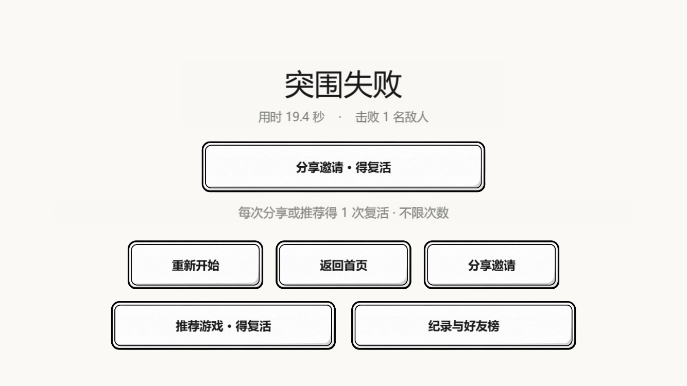

# 1.0.7 分享与推荐复活

日期：2026-11-13。当前源码与固定交付均为 **1.0.7**，第一、二关开放。按用户修订，将每关一次免费复活扩展为「首次免费，之后通过分享邀请或推荐游戏继续获得」，保留通关选关、好友榜、个人纪录和已修复的武器伤害。

## 当前规则

- 每关每次挑战默认 1 次免费原地复活。用完后，失败页显示「分享邀请 · 得复活」与「推荐游戏 · 得复活」。两种方式都可以反复使用，不限制总次数。
- 用户明确选择 **发起分享即获得**：微信主动分享请求发出且未抛错，发放 1 次；取消分享也保留机会。缺接口、调用失败不发放；临时封面失败后的打包封面重试只算一次。首页、暂停、纪录页和右上角菜单的普通分享不额外累积机会。
- 推荐使用已有微信官方组件。自然关闭返回严格的 `isRecommended === true` 时发放 1 次；这也可能是之前已经推荐的状态，不统计成新增推荐。取消等待、未推荐、缺字段、接口失败和主动销毁不发放。
- 微信星级/文字评价仍在微信评分主页进行；当前没有已核验的完成回调，本版没有假装接通「评价成功奖励」。按钮明确命名为「推荐游戏」。依据：[微信评价与推荐指南](https://developers.weixin.qq.com/minigame/dev/guide/open-ability/game-evaluate.html)、[官方 API 类型](https://github.com/wechat-miniprogram/minigame-api-typings/blob/master/types/wx/lib.wx.api.d.ts)。推荐指南不提倡用道具刺激推荐；本版奖励为用户指定的产品规则，实际平台审核未执行。
- 每次只保留 1 个待用机会，不囤积。返回后仍停留失败页，点击「原地复活 · 满血继续」才恢复。找不到安全复活位置不会扣除机会。
- 发放绑定当前挑战与死亡轮次；重复、迟到回调或重开后的旧结果无法给新一局加次数。重开和切关恢复 1 次免费机会，不继承未用奖励。
- 继续沿用满血、1 秒准备、3 秒保护，保留敌人/Boss 状态、装备弹药及已消耗补给。所有复活通关都保存进度、允许选关，但不更新最快纪录。

## 验证

| 项目 | 结果 |
| --- | --- |
| 类型检查与工程资源/引用检查 | 通过 |
| 逻辑回归 | 524 / 524，通过两关各 20 次额外复活及跨局次重复结果检查 |
| 最终固定 Web 包 | 3 组复活流程：第一、二关分别正常输入自然死亡 4 次并复活 4 次；另测普通 Web 无分享能力时重开 |
| 推荐兼容 | 13 组通过：展示、关闭三态、取消、弱网、清理异常、旧版本、四种横屏与竖屏恢复 |
| 分享兼容 | 5 组通过：正常、封面加载中、空导出、导出失败、临时封面失效 |
| 两关冒烟 | 加载、键盘移动/射击、暂停恢复通过 |
| 新失败页操作 | 667×375 触摸目标至少 44 逻辑像素；已检查两关截图 |
| 微信开发者工具 / iOS / Android | 未运行；真实分享、推荐、好友关系链仍待验收 |

第二关验收使用明确声明的旧通关存档进入正式选关；测试只编辑存档夹具和模拟平台接口，战斗通过真实键盘/触摸，不修改血量、不传送、不调用游戏内部复活方法。没有向真实好友发消息或代玩家提交推荐。浏览器通过不代表微信真机通过。本轮没有重新声明整关难度/FPS 已验收。

证据：[总校验](../验证记录/v107-social-revive/verification.json)、[复活浏览器流程](../验证记录/v107-social-revive/browser.json)、[推荐兼容](../验证记录/v107-social-revive/recommendation/browser.json)、[分享兼容](../验证记录/v107-social-revive/share/browser.json)、[逻辑结果](../验证记录/v107-social-revive/logic-results.json)。

## 交付与发布边界

[微信固定目录](../../交付/版本/1.0.7/历史测试包/1.0.7-社交复活/wechatgame) · [微信压缩包](../../交付/版本/1.0.7/历史测试包/1.0.7-社交复活/线条突围-微信小游戏-1.0.7.zip) · [Web 压缩包](../../交付/版本/1.0.7/历史测试包/1.0.7-社交复活/线条突围-Web-1.0.7.zip) · [导入说明](../../交付/版本/1.0.7/历史测试包/1.0.7-社交复活/导入说明.txt)。

两平台来自同一构建输入 SHA-256 `84abff8b66191f112441e2a116938c4926f91c1c7ec0f059043fb71d1445b62a`；固定目录、压缩包及回读内容逐文件一致。微信 447 个文件，主包 3,864,129 字节，总包 20,927,030 字节，符合项目已有本地预算；这些数值不替代微信当次上传审核。保留修改前恢复点 `PRE-SHARE-REVIVE-20261113`，未覆盖任何旧包。

用户本轮要求同步 GitHub，范围为完整源码、运行资源、源素材、开发文档与验证报告；本地缓存、运营提交材料、大量原始截图、历史归档和构建压缩包不写入源码仓库。原 `/docs` Pages 内容仍为旧快照，本次不将它冒充最新微信版本。微信上传、送审、线上发布由后续发布操作完成，本轮未执行。

已更新开发方法中的请求奖励语义、推荐状态边界和跨局次幂等发放经验；项目与全局副本 14 个文件哈希一致。校验使用 js-yaml、相对链接与 SHA-256，未声称运行本机不可用的 Python 校验器。
